# Case-study results

This file is generated from the files in this folder: every table is printed from a CSV / XLSX / JSON output, every number comes from `run_summary.json` or the output files, and every image is a rendered output. Each step names its source file (paths are relative to this folder).

| | Baxter Sigma Spectrum Infusion System | Schneider-Electric Modicon M580 |
|---|---|---|
| CPE | `cpe:2.3:h:baxter:sigma_spectrum_infusion_system:-:*:*:*:*:*:*:*` | `cpe:2.3:h:schneider-electric:modicon_m580:-:*:*:*:*:*:*:*` |
| Folder | `baxter_sigma_spectrum_infusion_system/` | `schneider-electric_modicon_m580/` |
| CVEs fetched | 10 | 40 |
| CVEs with a complete chain | 9 | 11 |
| Distinct CWEs / CAPECs / techniques in the trees | 5 / 20 / 16 | 6 / 33 / 38 |
| Tactics with paths | 8 | 8 |
| Attack paths | 51 | 74 |
| Comprehensive tree (nodes / edges) | 201 / 200 | 283 / 282 |
| Deduplication mode | `per_tactic` | `per_tactic` |
| Latest NVD `lastModified` among the CVE records | 2026-06-17 | 2026-06-17 |

Reference data used (from the dataset files shipped in `../Py-scripts/datasets/`): CWE v4.16, CAPEC v3.9, ATT&CK Enterprise v16.1.

**Contents:** [1. Baxter Sigma Spectrum Infusion System](#1-baxter-sigma-spectrum-infusion-system), [2. Schneider-Electric Modicon M580](#2-schneider-electric-modicon-m580), [3. Manual validation: Baxter Sigma Spectrum Infusion System](#3-manual-validation-baxter-sigma-spectrum-infusion-system)

**Pipeline:** CVE -> CWE -> CAPEC -> ATT&CK technique / sub-technique -> tactic -> tactic trees -> comprehensive tree. Steps 1 to 9 in each device section follow that order.

### Files in each device folder

| Path (in each device folder) | Contents |
|---|---|
| `cve_data/` | One NVD JSON per CVE |
| `cve_data.xlsx` | CVE table |
| `cve_data_formated.xlsx` | Formatted review workbook |
| `Device_Attack_Pattern.xlsx` | All CVE -> CWE -> CAPEC -> technique rows |
| `device_compromise_dataset.xlsx` | The chains the trees are built from |
| `incomplete_chains.csv` | Dropped chains with reason |
| `outputs/tables/` | `cves.csv`, `cwes.csv`, `capecs.csv`, `tables.xlsx` |
| `outputs/tactic_trees/` | One tree per tactic (`.png` `.svg` `.html` `.json` `.dot`) and `tactic_summary.csv` |
| `outputs/comprehensive_tree/` | Combined tree, `summary.csv`, `dedup_comparison.csv`, `pruned_duplicates.csv` |
| `outputs/insights/` | `insights.md` / `.html` / `.json` |
| `outputs/figures/` | Layered CVE -> CWE -> CAPEC -> technique -> tactic figure of a CVE sample (`cti_chain_figure.png`, `.pdf`, `.svg`) with its node, edge, CVE and check CSVs; written by `cve2at cti-figure` |
| `sensitivity.csv` | Link-removal results |
| `sensitivity_critical_links.csv` | Most critical links |
| `run_summary.json` | Counts per stage and run times |

### Files in this folder

| Path | Contents |
|---|---|
| `baxter_sigma_spectrum_infusion_system/` | Results for the Baxter Sigma Spectrum Infusion System (see below) |
| `schneider-electric_modicon_m580/` | Results for the Schneider-Electric Modicon M580 (see below) |
| `validation_Baxter/` | Two-annotator validation of the 51 Baxter paths |
| `figures/` | `cti_chain_share_combined.pdf`, `.svg`, `.png`: share of each CTI layer that continues to the next, both devices in one figure |

### Both devices: share of each CTI layer that continues

Source: `figures/cti_chain_share_combined.png`. Five bars per device (CVE, CWE, CAPEC, technique, tactic): the Baxter Sigma Spectrum Infusion System on top, the Schneider-Electric Modicon M580 at the bottom. Blue items continue to the next layer; the others stop there. Hatching shows which link is missing (`////` no CWE, `xxxx` no CAPEC, `....` no technique), and a dashed outline marks tactics that are not reached. Each layer counts every entry found in the data for that device, including those that stop early.

<table>
<tr><td align="center">

<a href="figures/cti_chain_share_combined.pdf">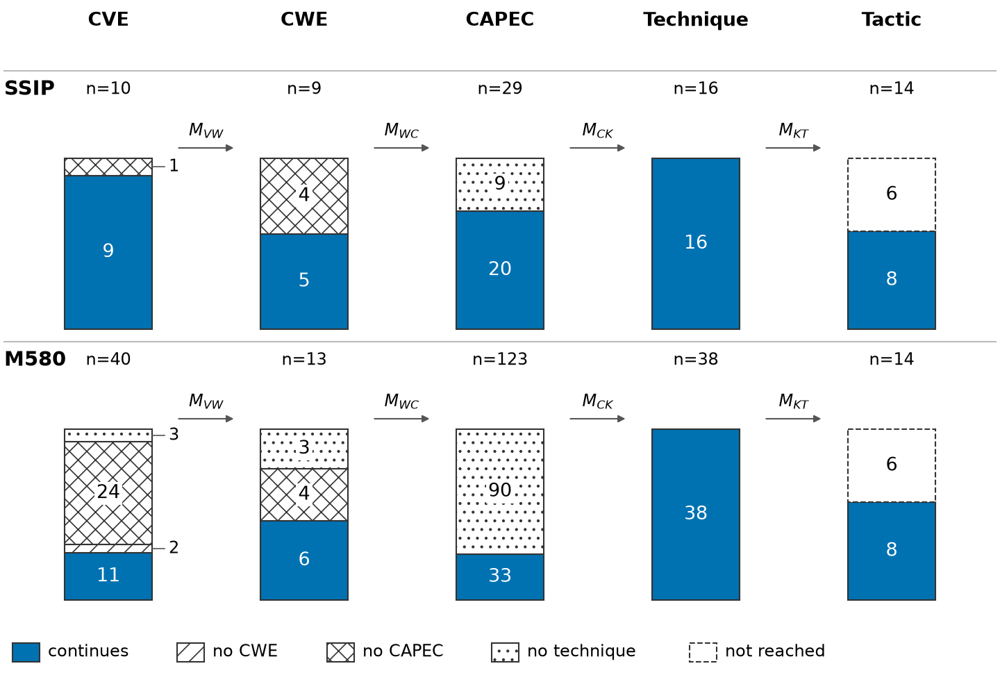</a>

</td></tr>
<tr><td align="center"><sub>Click for the PDF</sub></td></tr>
</table>

The figure is drawn from `cve_data.xlsx`, `device_compromise_dataset.xlsx`, `incomplete_chains.csv` and `run_summary.json` in each device folder. It is written only if its internal checks pass: every bar adds up, the tactic-by-weakness matrix sums to the number of attack paths, and the CVEs and CWEs that reach a tactic agree. To redraw it, from `Py-scripts/`:

```bash
cve2at cti-summary -w ../case_study_results/baxter_sigma_spectrum_infusion_system -w ../case_study_results/schneider-electric_modicon_m580
```

The command writes to `figures/` next to the two device folders. A single `-w` writes a two-panel summary for that device only (share of each layer that continues; paths by tactic and weakness) to its own `outputs/figures/`, which is not stored here.

---

## 1. Baxter Sigma Spectrum Infusion System

`cpe:2.3:h:baxter:sigma_spectrum_infusion_system:-:*:*:*:*:*:*:*`, folder `baxter_sigma_spectrum_infusion_system/`, run started 2026-10-03T21:37:24+00:00, total run time 5.6 s

### Step 1: CVEs

Source: `baxter_sigma_spectrum_infusion_system/outputs/tables/cves.csv` (the affected-components column is left out here; it is in the CSV). **10 CVEs fetched** (`run_summary.json`, `baxter_sigma_spectrum_infusion_system/cve_data/`); 10 have a usable CWE.

| CVE ID | CVSS Vector | CWE | Base | Expl. |
|---|---|---|---|---|
| CVE-2014-5431 | AV:P/AC:L/PR:N/UI:N/S:U/C:H/I:H/A:H | CWE-259, CWE-798 | 6.8 | 0.9 |
| CVE-2014-5432 | AV:N/AC:L/PR:N/UI:N/S:U/C:H/I:H/A:H | CWE-287, CWE-592 | 9.8 | 3.9 |
| CVE-2014-5433 | AV:N/AC:L/PR:N/UI:N/S:U/C:H/I:H/A:H | CWE-255, CWE-312 | 9.8 | 3.9 |
| CVE-2014-5434 | AV:N/AC:L/PR:N/UI:N/S:U/C:H/I:H/A:H | CWE-259, CWE-798 | 9.8 | 3.9 |
| CVE-2020-12039 | AV:P/AC:L/PR:N/UI:N/S:U/C:L/I:N/A:N | CWE-259, CWE-798 | 2.4 | 0.9 |
| CVE-2020-12040 | AV:N/AC:L/PR:N/UI:N/S:U/C:H/I:H/A:H | CWE-319 | 9.8 | 3.9 |
| CVE-2020-12041 | AV:N/AC:L/PR:N/UI:N/S:U/C:H/I:L/A:H | CWE-732 | 9.4 | 3.9 |
| CVE-2020-12043 | AV:N/AC:L/PR:N/UI:N/S:U/C:H/I:H/A:H | CWE-672 | 9.8 | 3.9 |
| CVE-2020-12045 | AV:N/AC:L/PR:N/UI:N/S:U/C:H/I:H/A:H | CWE-259, CWE-798 | 9.8 | 3.9 |
| CVE-2020-12047 | AV:N/AC:L/PR:N/UI:N/S:U/C:H/I:H/A:H | CWE-259, CWE-798 | 9.8 | 3.9 |

### Step 2: CWEs

Source: `baxter_sigma_spectrum_infusion_system/outputs/tables/cwes.csv`. **9 distinct CWEs** over 17 CVE -> CWE links; 5 are retained (`Retained = True`, i.e. the CWE continues to a CAPEC pattern).

| CWE | Name | Abstraction | Status | #CVE | Related CAPEC | Retained |
|---|---|---|---|---|---|---|
| CWE-255 | (not in reference dataset) |  |  | 1 | n/a | False |
| CWE-259 | Use of Hard-coded Password | Variant | Draft | 5 | n/a | False |
| CWE-287 | Improper Authentication | Class | Draft | 1 | 10 patterns | True |
| CWE-312 | Cleartext Storage of Sensitive Information | Base | Draft | 1 | 1 patterns | True |
| CWE-319 | Cleartext Transmission of Sensitive Information | Base | Draft | 1 | 5 patterns | True |
| CWE-592 | DEPRECATED: Authentication Bypass Issues | Class | Deprecated | 1 | n/a | False |
| CWE-672 | Operation on a Resource after Expiration or Release | Class | Draft | 1 | n/a | False |
| CWE-732 | Incorrect Permission Assignment for Critical Resource | Class | Draft | 1 | 11 patterns | True |
| CWE-798 | Use of Hard-coded Credentials | Base | Draft | 5 | 2 patterns | True |

### Step 3: CAPEC patterns

Source: `baxter_sigma_spectrum_infusion_system/outputs/tables/capecs.csv`. **29 patterns** are reachable from the retained CWEs.

<details open>
<summary>Show all 29 CAPEC patterns</summary>

| CAPEC | Name | Abstraction | Likelihood | Severity |
|---|---|---|---|---|
| CAPEC-1 | Accessing Functionality Not Properly Constrained by ACLs | Standard | High | High |
| CAPEC-17 | Using Malicious Files | Standard | High | Very High |
| CAPEC-22 | Exploiting Trust in Client | Meta | High | High |
| CAPEC-37 | Retrieve Embedded Sensitive Data | Detailed | High | Very High |
| CAPEC-57 | Utilizing REST's Trust in the System Resource to Obtain Sensitive Data | Detailed | Medium | Very High |
| CAPEC-60 | Reusing Session IDs (aka Session Replay) | Detailed | High | High |
| CAPEC-61 | Session Fixation | Detailed | Medium | High |
| CAPEC-62 | Cross Site Request Forgery | Standard | High | Very High |
| CAPEC-65 | Sniff Application Code | Detailed | Low | High |
| CAPEC-70 | Try Common or Default Usernames and Passwords | Detailed | Medium | High |
| CAPEC-94 | Adversary in the Middle (AiTM) | Meta | High | Very High |
| CAPEC-102 | Session Sidejacking | Detailed | High | High |
| CAPEC-114 | Authentication Abuse | Meta | n/a | Medium |
| CAPEC-115 | Authentication Bypass | Meta | n/a | Medium |
| CAPEC-117 | Interception | Meta | Low | Medium |
| CAPEC-122 | Privilege Abuse | Meta | High | Medium |
| CAPEC-127 | Directory Indexing | Detailed | High | Medium |
| CAPEC-151 | Identity Spoofing | Meta | Medium | Medium |
| CAPEC-180 | Exploiting Incorrectly Configured Access Control Security Levels | Standard | High | Medium |
| CAPEC-191 | Read Sensitive Constants Within an Executable | Detailed | n/a | Low |
| CAPEC-194 | Fake the Source of Data | Standard | n/a | Medium |
| CAPEC-206 | Signing Malicious Code | Detailed | n/a | Very High |
| CAPEC-234 | Hijacking a privileged process | Standard | n/a | Medium |
| CAPEC-383 | Harvesting Information via API Event Monitoring | Detailed | n/a | Low |
| CAPEC-477 | Signature Spoofing by Mixing Signed and Unsigned Content | Detailed | Low | High |
| CAPEC-593 | Session Hijacking | Standard | High | Very High |
| CAPEC-633 | Token Impersonation | Detailed | n/a | Medium |
| CAPEC-642 | Replace Binaries | Detailed | n/a | High |
| CAPEC-650 | Upload a Web Shell to a Web Server | Detailed | n/a | High |

</details>

### Step 4: Chains dropped

Sources: `baxter_sigma_spectrum_infusion_system/incomplete_chains.csv`, `baxter_sigma_spectrum_infusion_system/run_summary.json`. **17 chain rows dropped** (9 of the 80 rows built, which have no technique, and 8 that stop earlier: 7 without a CAPEC pattern, 1 with an unknown CWE); **9 of 10 CVEs** keep at least one complete chain.

| Reason code | Meaning (insights.json) | Rows dropped |
|---|---|---|
| NO_TECHNIQUE | CAPEC pattern has no ATT&CK technique | 9 |
| NO_CAPEC | CWE has no usable CAPEC pattern | 7 |
| CWE_UNKNOWN | CWE not in the reference set | 1 |

<details>
<summary>Show all 17 dropped rows</summary>

| CVE ID | CWE ID | chain_break | CAPEC_ID |
|---|---|---|---|
| CVE-2014-5433 | 255 | CWE_UNKNOWN |  |
| CVE-2014-5431 | 259 | NO_CAPEC |  |
| CVE-2014-5432 | 592 | NO_CAPEC |  |
| CVE-2014-5434 | 259 | NO_CAPEC |  |
| CVE-2020-12039 | 259 | NO_CAPEC |  |
| CVE-2020-12043 | 672 | NO_CAPEC |  |
| CVE-2020-12045 | 259 | NO_CAPEC |  |
| CVE-2020-12047 | 259 | NO_CAPEC |  |
| CVE-2014-5432 | 287 | NO_TECHNIQUE | 151.0 |
| CVE-2014-5432 | 287 | NO_TECHNIQUE | 194.0 |
| CVE-2014-5432 | 287 | NO_TECHNIQUE | 22.0 |
| CVE-2020-12040 | 319 | NO_TECHNIQUE | 102.0 |
| CVE-2020-12040 | 319 | NO_TECHNIQUE | 117.0 |
| CVE-2020-12040 | 319 | NO_TECHNIQUE | 477.0 |
| CVE-2020-12041 | 732 | NO_TECHNIQUE | 234.0 |
| CVE-2020-12041 | 732 | NO_TECHNIQUE | 61.0 |
| CVE-2020-12041 | 732 | NO_TECHNIQUE | 62.0 |

</details>

### Step 5: Technique and tactic mapping

Source: `baxter_sigma_spectrum_infusion_system/device_compromise_dataset.xlsx` (80 rows loaded, **71 complete chains kept**, 9 dropped). These reach 20 CAPEC patterns and 16 techniques in 8 tactics. Chains per CVE:

| CVE ID | CWE | CAPECs | Techniques | Tactics |
|---|---|---|---|---|
| CVE-2014-5431 | CWE-798 | 2 | 2 | Credential Access, Defense Evasion, Initial Access, Persistence, Privilege Escalation |
| CVE-2014-5432 | CWE-287 | 7 | 8 | Collection, Credential Access, Defense Evasion, Discovery, Lateral Movement, Persistence, Privilege Escalation |
| CVE-2014-5433 | CWE-312 | 1 | 2 | Collection, Credential Access |
| CVE-2014-5434 | CWE-798 | 2 | 2 | Credential Access, Defense Evasion, Initial Access, Persistence, Privilege Escalation |
| CVE-2020-12039 | CWE-798 | 2 | 2 | Credential Access, Defense Evasion, Initial Access, Persistence, Privilege Escalation |
| CVE-2020-12040 | CWE-319 | 2 | 2 | Collection, Credential Access, Discovery |
| CVE-2020-12041 | CWE-732 | 8 | 9 | Defense Evasion, Discovery, Lateral Movement, Persistence, Privilege Escalation |
| CVE-2020-12045 | CWE-798 | 2 | 2 | Credential Access, Defense Evasion, Initial Access, Persistence, Privilege Escalation |
| CVE-2020-12047 | CWE-798 | 2 | 2 | Credential Access, Defense Evasion, Initial Access, Persistence, Privilege Escalation |

First rows of the file:

| CVE ID | CWE ID | CAPEC_ID | Technique_ID_Only | tactics |
|---|---|---|---|---|
| CVE-2014-5431 | CWE-798 | CAPEC-191 | T1552.001 | Credential Access |
| CVE-2014-5431 | CWE-798 | CAPEC-70 | T1078.001 | Defense Evasion |
| CVE-2014-5431 | CWE-798 | CAPEC-70 | T1078.001 | Initial Access |
| CVE-2014-5431 | CWE-798 | CAPEC-70 | T1078.001 | Persistence |
| CVE-2014-5431 | CWE-798 | CAPEC-70 | T1078.001 | Privilege Escalation |
| CVE-2014-5432 | CWE-287 | CAPEC-114 | T1548 | Defense Evasion |

The share of each CTI layer that continues to the next (Baxter: top panel) is in `figures/cti_chain_share_combined.png`, shown in [Both devices](#both-devices-share-of-each-cti-layer-that-continues).

### Step 6: Tactic-level trees

Source: `baxter_sigma_spectrum_infusion_system/outputs/tactic_trees/tactic_summary.csv`.

| tactic | paths | unique_cwes | unique_techniques | unique_capecs |
|---|---|---|---|---|
| Initial Access | 1 | 1 | 1 | 1 |
| Persistence | 9 | 3 | 4 | 6 |
| Privilege Escalation | 11 | 3 | 4 | 10 |
| Defense Evasion | 14 | 3 | 6 | 12 |
| Credential Access | 6 | 4 | 4 | 6 |
| Discovery | 3 | 3 | 2 | 3 |
| Lateral Movement | 3 | 2 | 2 | 2 |
| Collection | 4 | 3 | 4 | 4 |
| TOTAL | 51 | 5 | 16 | 20 |

Each tree exists as `.png`, `.svg`, `.html` (interactive), `.json` and `.dot` in `baxter_sigma_spectrum_infusion_system/outputs/tactic_trees/`; click an image for the SVG. The two narrowest trees are expanded, the others are collapsed because of their width.

Node key (read from the `.dot` files):

| Node | Shape | Fill | Example label (from the .dot file) |
|---|---|---|---|
| Root | box | #FFD700 | Compromise(Device) |
| Tactic | box | #98FB98 | Initial Access |
| CWE | note | #ADD8E6 | Use of Hard-coded Credentials |
| Technique | box | #90EE90 | Compromise Host Software Binary |
| Sub-technique | box | #FFFACD | Valid Accounts: Default Accounts |
| CAPEC pattern | box | #FFB6C1 | Try Common or Default Usernames and Passwords |
| AND gate | ellipse | #FFCCCB | AND |
| OR gate | ellipse | #FFCCCB | OR |

**Initial Access**: 1 paths, 1 CWEs, 1 techniques, 1 CAPECs (768 px wide)

<table>
<tr><td align="center">

<a href="baxter_sigma_spectrum_infusion_system/outputs/tactic_trees/Initial_Access.svg">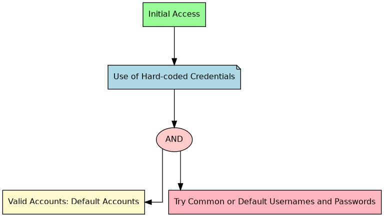</a>

</td></tr>
<tr><td align="center"><sub>Initial_Access.png</sub></td></tr>
</table>


<details>
<summary>**Persistence**: 9 paths, 3 CWEs, 4 techniques, 6 CAPECs (6174 px wide)</summary>

<table>
<tr><td align="center">

<a href="baxter_sigma_spectrum_infusion_system/outputs/tactic_trees/Persistence.svg">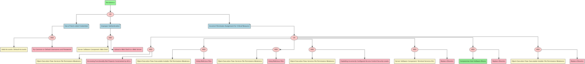</a>

</td></tr>
<tr><td align="center"><sub>Persistence.png</sub></td></tr>
</table>


</details>

<details>
<summary>**Privilege Escalation**: 11 paths, 3 CWEs, 4 techniques, 10 CAPECs (8009 px wide)</summary>

<table>
<tr><td align="center">

<a href="baxter_sigma_spectrum_infusion_system/outputs/tactic_trees/Privilege_Escalation.svg">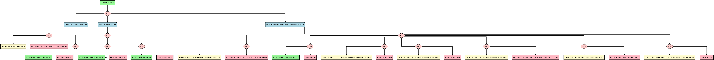</a>

</td></tr>
<tr><td align="center"><sub>Privilege_Escalation.png</sub></td></tr>
</table>


</details>

<details>
<summary>**Defense Evasion**: 14 paths, 3 CWEs, 6 techniques, 12 CAPECs (10223 px wide)</summary>

<table>
<tr><td align="center">

<a href="baxter_sigma_spectrum_infusion_system/outputs/tactic_trees/Defense_Evasion.svg"></a>

</td></tr>
<tr><td align="center"><sub>Defense_Evasion.png</sub></td></tr>
</table>


</details>

<details>
<summary>**Credential Access**: 6 paths, 4 CWEs, 4 techniques, 6 CAPECs (2869 px wide)</summary>

<table>
<tr><td align="center">

<a href="baxter_sigma_spectrum_infusion_system/outputs/tactic_trees/Credential_Access.svg">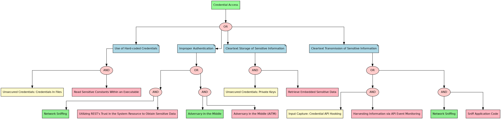</a>

</td></tr>
<tr><td align="center"><sub>Credential_Access.png</sub></td></tr>
</table>


</details>

**Discovery**: 3 paths, 3 CWEs, 2 techniques, 3 CAPECs (1741 px wide)

<table>
<tr><td align="center">

<a href="baxter_sigma_spectrum_infusion_system/outputs/tactic_trees/Discovery.svg">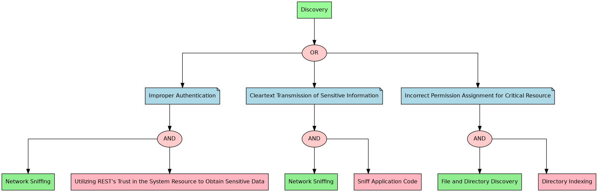</a>

</td></tr>
<tr><td align="center"><sub>Discovery.png</sub></td></tr>
</table>


<details>
<summary>**Lateral Movement**: 3 paths, 2 CWEs, 2 techniques, 2 CAPECs (1939 px wide)</summary>

<table>
<tr><td align="center">

<a href="baxter_sigma_spectrum_infusion_system/outputs/tactic_trees/Lateral_Movement.svg">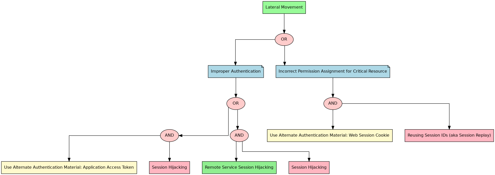</a>

</td></tr>
<tr><td align="center"><sub>Lateral_Movement.png</sub></td></tr>
</table>


</details>

<details>
<summary>**Collection**: 4 paths, 3 CWEs, 4 techniques, 4 CAPECs (2073 px wide)</summary>

<table>
<tr><td align="center">

<a href="baxter_sigma_spectrum_infusion_system/outputs/tactic_trees/Collection.svg">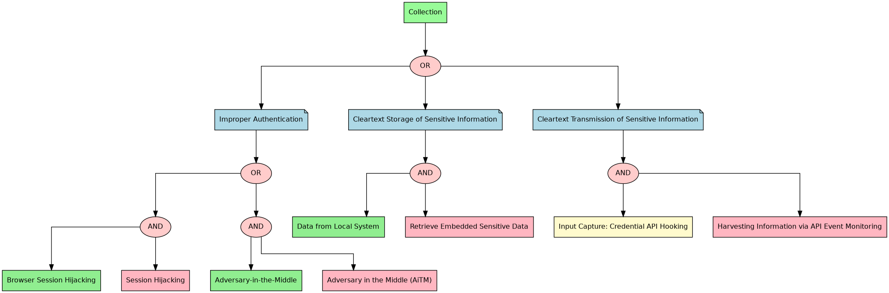</a>

</td></tr>
<tr><td align="center"><sub>Collection.png</sub></td></tr>
</table>


</details>

### Step 7: Comprehensive tree

Sources: `baxter_sigma_spectrum_infusion_system/outputs/comprehensive_tree/summary.csv`, `dedup_comparison.csv`, `run_summary.json`. **51 paths, 201 nodes, 200 edges, 8 tactics.**

| dedup_mode | total_paths | total_nodes | total_edges | cross_tactic_duplicates_removed | pruned_rows_cross_tactic | pruned_rows_within_tactic | tactics_represented |
|---|---|---|---|---|---|---|---|
| per_tactic | 51 | 201 | 200 | 0 | 36 | 8 | 8 |

Paths kept per tactic under each deduplication rule (`dedup_comparison.csv`; the run used `per_tactic`):

| tactic | per_tactic_count | earliest_tactic_count | difference |
|---|---|---|---|
| Initial Access | 1 | 1 | 0 |
| Persistence | 9 | 8 | 1 |
| Privilege Escalation | 11 | 5 | 6 |
| Defense Evasion | 14 | 3 | 11 |
| Credential Access | 6 | 6 | 0 |
| Discovery | 3 | 1 | 2 |
| Lateral Movement | 3 | 1 | 2 |
| Collection | 4 | 2 | 2 |
| TOTAL | 51 | 27 | 24 |

The tree is drawn left to right, so it is tall rather than wide (3,699 × 6,477 px for Baxter), and the box below shows it scaled down (text is small). Full-size: [`.svg`](baxter_sigma_spectrum_infusion_system/outputs/comprehensive_tree/comprehensive_attack_tree.svg), [`.png`](baxter_sigma_spectrum_infusion_system/outputs/comprehensive_tree/comprehensive_attack_tree.png), [`.html`](baxter_sigma_spectrum_infusion_system/outputs/comprehensive_tree/comprehensive_attack_tree.html) (interactive).

<table>
<tr><td align="center">

<a href="baxter_sigma_spectrum_infusion_system/outputs/comprehensive_tree/comprehensive_attack_tree.svg">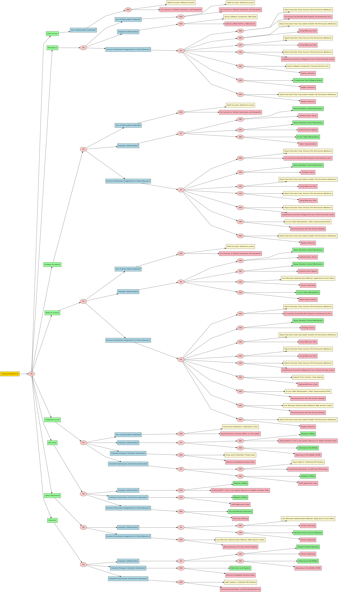</a>

</td></tr>
<tr><td align="center"><sub>Comprehensive attack tree (scaled down) : click for the full SVG</sub></td></tr>
</table>

### Step 8: Sensitivity to missing CTI links

Sources: `baxter_sigma_spectrum_infusion_system/sensitivity.csv`, `baxter_sigma_spectrum_infusion_system/sensitivity_critical_links.csv`. Links of the given type are removed at random with probability *p* (500 replicates, seed 2026). Share of the 51 paths retained, mean [bootstrap CI]:

| Links removed | p = 0.1 | p = 0.2 | p = 0.3 | p = 0.4 | p = 0.5 |
|---|---|---|---|---|---|
| cve_cwe | 0.902 [0.884, 0.918] | 0.817 [0.796, 0.837] | 0.738 [0.716, 0.761] | 0.630 [0.606, 0.655] | 0.534 [0.510, 0.561] |
| cwe_capec | 0.895 [0.888, 0.901] | 0.802 [0.794, 0.811] | 0.699 [0.689, 0.709] | 0.614 [0.603, 0.625] | 0.499 [0.488, 0.510] |
| capec_technique | 0.898 [0.892, 0.903] | 0.792 [0.785, 0.800] | 0.699 [0.691, 0.707] | 0.599 [0.590, 0.608] | 0.501 [0.492, 0.509] |
| technique_tactic | 0.899 [0.894, 0.904] | 0.797 [0.791, 0.804] | 0.696 [0.689, 0.703] | 0.603 [0.595, 0.611] | 0.501 [0.493, 0.509] |
| all | 0.667 [0.654, 0.679] | 0.421 [0.409, 0.434] | 0.256 [0.246, 0.268] | 0.136 [0.128, 0.144] | 0.069 [0.064, 0.074] |

Share of the 8 tactics that keep at least one path (mean):

| Links removed | p = 0.1 | p = 0.2 | p = 0.3 | p = 0.4 | p = 0.5 |
|---|---|---|---|---|---|
| cve_cwe | 0.998 | 0.993 | 0.989 | 0.959 | 0.927 |
| cwe_capec | 0.981 | 0.969 | 0.952 | 0.920 | 0.877 |
| capec_technique | 0.985 | 0.970 | 0.960 | 0.930 | 0.902 |
| technique_tactic | 0.984 | 0.971 | 0.948 | 0.918 | 0.870 |
| all | 0.948 | 0.839 | 0.685 | 0.494 | 0.306 |

Single CVE -> CWE links, ranked by paths lost:

| Rank | CVE -> CWE link removed | Paths lost | Share |
|---|---|---|---|
| 1 | CVE-2020-12041 -> CWE-732 | 25 | 49.0% |
| 2 | CVE-2014-5432 -> CWE-287 | 15 | 29.4% |
| 3 | CVE-2020-12040 -> CWE-319 | 4 | 7.8% |
| 4 | CVE-2014-5433 -> CWE-312 | 2 | 3.9% |
| 5 | CVE-2014-5431 -> CWE-798 | 0 | 0.0% |

Greedy removal of CWE -> CAPEC links:

| Step | CWE -> CAPEC link removed (greedy) | Paths lost | Cumulative lost | Cumulative share |
|---|---|---|---|---|
| 1 | CWE-732 -> CAPEC-17 | 6 | 6 | 11.8% |
| 2 | CWE-732 -> CAPEC-642 | 5 | 11 | 21.6% |
| 3 | CWE-287 -> CAPEC-593 | 4 | 15 | 29.4% |
| 4 | CWE-732 -> CAPEC-60 | 4 | 19 | 37.3% |
| 5 | CWE-798 -> CAPEC-70 | 4 | 23 | 45.1% |

### Step 9: Insights

Source: `baxter_sigma_spectrum_infusion_system/outputs/insights/insights.json` (also `.md`, `.html`). Overview: CVEs in scope 10, CVEs reaching a tactic 9, Weaknesses 5, CAPEC patterns 20, Techniques 16, Tactics 8, Paths 51.

1. **One weakness, many stages** :Use of Hard-coded Credentials (CWE-798) underlies 5 of 10 CVEs and reaches 5 of 8 tactic subtrees. Ranked one by one they read as separate findings; the tree groups them under one recurring weakness.
2. **Path count is not CVE count** :Defense Evasion has 14 paths from 7 CVEs, while Initial Access has 1 path from 5 CVEs. CVE count is only a rough guide to how many paths a tactic opens.
3. **Redundancy shows where one control helps twice**: 44 CAPEC references collapse to 20 distinct patterns (54.5% repeat one already used in another tactic). The same mechanisms recur across stages, so one control can cut paths in several of them.
4. **Where a fix removes the most paths** :Fixing CVE-2020-12041 alone removes 25 of 51 paths (49.0%), the most of any single CVE. Its base score ranks only #7 of 9, so severity alone would not point to it.
5. **How easily the paths can be reached**: 51 of 51 paths (100.0%) can be driven remotely: at least one supporting CVE is reachable over the network with no privileges and no user interaction.
6. **Which weakness feeds the most paths** :Incorrect Permission Assignment for Critical Resource (CWE-732) supports 25 of 51 paths (49.0%) from 1 CVE.
7. **Where public mappings run out** :The paths reach 8 of 14 ATT&CK tactics. Most dropped chain rows (9 of 17) are lost at one step: CAPEC pattern has no ATT&CK technique.

---

## 2. Schneider-Electric Modicon M580

`cpe:2.3:h:schneider-electric:modicon_m580:-:*:*:*:*:*:*:*`, folder `schneider-electric_modicon_m580/`, run started 2026-10-03T21:37:37+00:00, total run time 8.7 s

### Step 1: CVEs

Source: `schneider-electric_modicon_m580/outputs/tables/cves.csv` (the affected-components column is left out here; it is in the CSV). **40 CVEs fetched** (`run_summary.json`, `schneider-electric_modicon_m580/cve_data/`); 38 have a usable CWE.

| CVE ID | CVSS Vector | CWE | Base | Expl. |
|---|---|---|---|---|
| CVE-2018-7794 | AV:N/AC:L/PR:N/UI:N/S:U/C:N/I:N/A:H | CWE-754 | 7.5 | 3.9 |
| CVE-2018-7842 | AV:N/AC:L/PR:N/UI:N/S:U/C:H/I:H/A:H | CWE-290 | 9.8 | 3.9 |
| CVE-2018-7843 | AV:N/AC:L/PR:N/UI:N/S:U/C:N/I:N/A:H | CWE-125 | 7.5 | 3.9 |
| CVE-2018-7844 | AV:N/AC:L/PR:N/UI:N/S:U/C:H/I:N/A:N | CWE-200 | 7.5 | 3.9 |
| CVE-2018-7845 | AV:N/AC:L/PR:N/UI:N/S:U/C:H/I:N/A:N | CWE-125 | 7.5 | 3.9 |
| CVE-2018-7846 | AV:N/AC:L/PR:N/UI:N/S:U/C:H/I:H/A:H | CWE-668 | 9.8 | 3.9 |
| CVE-2018-7847 | AV:N/AC:L/PR:N/UI:N/S:U/C:H/I:H/A:H | CWE-287 | 9.8 | 3.9 |
| CVE-2018-7848 | AV:N/AC:L/PR:N/UI:N/S:U/C:H/I:N/A:N | CWE-200 | 7.5 | 3.9 |
| CVE-2018-7849 | AV:N/AC:L/PR:N/UI:N/S:U/C:N/I:N/A:H | CWE-755 | 7.5 | 3.9 |
| CVE-2018-7850 | AV:N/AC:L/PR:N/UI:N/S:U/C:L/I:N/A:N |  | 5.3 | 3.9 |
| CVE-2018-7852 | AV:N/AC:L/PR:N/UI:N/S:U/C:N/I:N/A:H | CWE-248, CWE-755 | 7.5 | 3.9 |
| CVE-2018-7853 | AV:N/AC:L/PR:N/UI:N/S:U/C:N/I:N/A:H | CWE-754 | 7.5 | 3.9 |
| CVE-2018-7854 | AV:N/AC:L/PR:N/UI:N/S:U/C:N/I:N/A:H | CWE-754 | 7.5 | 3.9 |
| CVE-2018-7855 | AV:N/AC:L/PR:N/UI:N/S:U/C:N/I:N/A:H | CWE-754 | 7.5 | 3.9 |
| CVE-2018-7856 | AV:N/AC:L/PR:N/UI:N/S:U/C:N/I:N/A:H | CWE-754 | 7.5 | 3.9 |
| CVE-2018-7857 | AV:N/AC:L/PR:N/UI:N/S:U/C:N/I:N/A:H | CWE-754 | 7.5 | 3.9 |
| CVE-2019-6806 | AV:N/AC:L/PR:N/UI:N/S:U/C:H/I:N/A:N |  | 7.5 | 3.9 |
| CVE-2019-6807 | AV:N/AC:L/PR:N/UI:N/S:U/C:N/I:N/A:H | CWE-755 | 7.5 | 3.9 |
| CVE-2019-6808 | AV:N/AC:L/PR:N/UI:N/S:U/C:H/I:H/A:H | CWE-306 | 9.8 | 3.9 |
| CVE-2019-6809 | AV:N/AC:L/PR:N/UI:N/S:U/C:N/I:N/A:H | CWE-248, CWE-755 | 7.5 | 3.9 |
| CVE-2019-6821 | AV:N/AC:L/PR:N/UI:N/S:U/C:L/I:L/A:N | CWE-330 | 6.5 | 3.9 |
| CVE-2019-6828 | AV:N/AC:L/PR:N/UI:N/S:U/C:N/I:N/A:H | CWE-248, CWE-755 | 7.5 | 3.9 |
| CVE-2019-6829 | AV:N/AC:L/PR:N/UI:N/S:U/C:N/I:N/A:H | CWE-248, CWE-755 | 7.5 | 3.9 |
| CVE-2019-6830 | AV:N/AC:H/PR:N/UI:N/S:U/C:N/I:N/A:H | CWE-248, CWE-755 | 5.9 | 2.2 |
| CVE-2019-6841 | AV:N/AC:L/PR:H/UI:N/S:U/C:N/I:N/A:H | CWE-755 | 4.9 | 1.2 |
| CVE-2019-6842 | AV:N/AC:L/PR:H/UI:N/S:U/C:N/I:N/A:H | CWE-755 | 4.9 | 1.2 |
| CVE-2019-6843 | AV:N/AC:L/PR:H/UI:N/S:U/C:N/I:N/A:H | CWE-755 | 4.9 | 1.2 |
| CVE-2019-6844 | AV:N/AC:L/PR:H/UI:N/S:U/C:N/I:N/A:H | CWE-755 | 4.9 | 1.2 |
| CVE-2019-6845 | AV:N/AC:L/PR:N/UI:N/S:U/C:H/I:N/A:N | CWE-319 | 7.5 | 3.9 |
| CVE-2019-6846 | AV:N/AC:L/PR:N/UI:R/S:U/C:H/I:N/A:N | CWE-319 | 6.5 | 2.8 |
| CVE-2019-6847 | AV:N/AC:L/PR:H/UI:N/S:U/C:N/I:N/A:H | CWE-755 | 4.9 | 1.2 |
| CVE-2019-6848 | AV:N/AC:L/PR:N/UI:N/S:C/C:N/I:N/A:H | CWE-755 | 8.6 | 3.9 |
| CVE-2019-6849 | AV:N/AC:L/PR:N/UI:N/S:U/C:H/I:N/A:N | CWE-200 | 7.5 | 3.9 |
| CVE-2019-6850 | AV:N/AC:L/PR:N/UI:N/S:U/C:H/I:N/A:N | CWE-200 | 7.5 | 3.9 |
| CVE-2019-6851 | AV:N/AC:L/PR:N/UI:N/S:U/C:H/I:N/A:N | CWE-200, CWE-538 | 7.5 | 3.9 |
| CVE-2019-6856 | AV:N/AC:L/PR:N/UI:N/S:U/C:N/I:N/A:H | CWE-754 | 7.5 | 3.9 |
| CVE-2019-6857 | AV:N/AC:L/PR:N/UI:N/S:U/C:N/I:N/A:H | CWE-754 | 7.5 | 3.9 |
| CVE-2020-7475 | AV:N/AC:L/PR:N/UI:N/S:U/C:H/I:H/A:H | CWE-74 | 9.8 | 3.9 |
| CVE-2023-25619 | AV:N/AC:L/PR:N/UI:N/S:U/C:N/I:N/A:H | CWE-754 | 7.5 | 3.9 |
| CVE-2023-25620 | AV:N/AC:L/PR:L/UI:N/S:U/C:N/I:N/A:H | CWE-754 | 6.5 | 2.8 |

### Step 2: CWEs

Source: `schneider-electric_modicon_m580/outputs/tables/cwes.csv`. **13 distinct CWEs** over 44 CVE -> CWE links; 9 are retained (`Retained = True`, i.e. the CWE continues to a CAPEC pattern).

| CWE | Name | Abstraction | Status | #CVE | Related CAPEC | Retained |
|---|---|---|---|---|---|---|
| CWE-74 | Improper Neutralization of Special Elements in Output Used by a Downstream Component ('Injection') | Class | Incomplete | 1 | 37 patterns | True |
| CWE-125 | Out-of-bounds Read | Base | Draft | 2 | 1 patterns | True |
| CWE-200 | Exposure of Sensitive Information to an Unauthorized Actor | Class | Draft | 5 | 59 patterns | True |
| CWE-248 | Uncaught Exception | Base | Draft | 5 | n/a | False |
| CWE-287 | Improper Authentication | Class | Draft | 1 | 10 patterns | True |
| CWE-290 | Authentication Bypass by Spoofing | Base | Incomplete | 1 | 10 patterns | True |
| CWE-306 | Missing Authentication for Critical Function | Base | Draft | 1 | 5 patterns | True |
| CWE-319 | Cleartext Transmission of Sensitive Information | Base | Draft | 2 | 5 patterns | True |
| CWE-330 | Use of Insufficiently Random Values | Class | Stable | 1 | 3 patterns | True |
| CWE-538 | Insertion of Sensitive Information into Externally-Accessible File or Directory | Base | Draft | 1 | 1 patterns | True |
| CWE-668 | Exposure of Resource to Wrong Sphere | Class | Draft | 1 | n/a | False |
| CWE-754 | Improper Check for Unusual or Exceptional Conditions | Class | Incomplete | 10 | n/a | False |
| CWE-755 | Improper Handling of Exceptional Conditions | Class | Incomplete | 13 | n/a | False |

### Step 3: CAPEC patterns

Source: `schneider-electric_modicon_m580/outputs/tables/capecs.csv`. **123 patterns** are reachable from the retained CWEs.

<details>
<summary>Show all 123 CAPEC patterns</summary>

| CAPEC | Name | Abstraction | Likelihood | Severity |
|---|---|---|---|---|
| CAPEC-3 | Using Leading 'Ghost' Character Sequences to Bypass Input Filters | Detailed | Medium | Medium |
| CAPEC-6 | Argument Injection | Standard | High | High |
| CAPEC-7 | Blind SQL Injection | Detailed | High | High |
| CAPEC-8 | Buffer Overflow in an API Call | Detailed | High | High |
| CAPEC-9 | Buffer Overflow in Local Command-Line Utilities | Detailed | High | High |
| CAPEC-10 | Buffer Overflow via Environment Variables | Detailed | High | High |
| CAPEC-12 | Choosing Message Identifier | Standard | High | High |
| CAPEC-13 | Subverting Environment Variable Values | Detailed | High | Very High |
| CAPEC-14 | Client-side Injection-induced Buffer Overflow | Detailed | Medium | High |
| CAPEC-21 | Exploitation of Trusted Identifiers | Meta | High | High |
| CAPEC-22 | Exploiting Trust in Client | Meta | High | High |
| CAPEC-24 | Filter Failure through Buffer Overflow | Detailed | High | High |
| CAPEC-28 | Fuzzing | Meta | High | Medium |
| CAPEC-34 | HTTP Response Splitting | Detailed | Medium | High |
| CAPEC-36 | Using Unpublished Interfaces or Functionality | Standard | Medium | High |
| CAPEC-42 | MIME Conversion | Detailed | High | High |
| CAPEC-43 | Exploiting Multiple Input Interpretation Layers | Detailed | Medium | High |
| CAPEC-45 | Buffer Overflow via Symbolic Links | Detailed | High | High |
| CAPEC-46 | Overflow Variables and Tags | Detailed | High | High |
| CAPEC-47 | Buffer Overflow via Parameter Expansion | Detailed | Medium | High |
| CAPEC-51 | Poison Web Service Registry | Detailed | High | Very High |
| CAPEC-52 | Embedding NULL Bytes | Detailed | High | High |
| CAPEC-53 | Postfix, Null Terminate, and Backslash | Detailed | High | High |
| CAPEC-57 | Utilizing REST's Trust in the System Resource to Obtain Sensitive Data | Detailed | Medium | Very High |
| CAPEC-59 | Session Credential Falsification through Prediction | Detailed | High | High |
| CAPEC-60 | Reusing Session IDs (aka Session Replay) | Detailed | High | High |
| CAPEC-62 | Cross Site Request Forgery | Standard | High | Very High |
| CAPEC-64 | Using Slashes and URL Encoding Combined to Bypass Validation Logic | Detailed | High | High |
| CAPEC-65 | Sniff Application Code | Detailed | Low | High |
| CAPEC-67 | String Format Overflow in syslog() | Detailed | High | Very High |
| CAPEC-71 | Using Unicode Encoding to Bypass Validation Logic | Detailed | Medium | High |
| CAPEC-72 | URL Encoding | Detailed | High | High |
| CAPEC-76 | Manipulating Web Input to File System Calls | Detailed | High | Very High |
| CAPEC-78 | Using Escaped Slashes in Alternate Encoding | Detailed | High | High |
| CAPEC-79 | Using Slashes in Alternate Encoding | Detailed | High | High |
| CAPEC-80 | Using UTF-8 Encoding to Bypass Validation Logic | Detailed | High | High |
| CAPEC-83 | XPath Injection | Detailed | High | High |
| CAPEC-84 | XQuery Injection | Detailed | High | Very High |
| CAPEC-94 | Adversary in the Middle (AiTM) | Meta | High | Very High |
| CAPEC-95 | WSDL Scanning | Detailed | High | High |
| CAPEC-101 | Server Side Include (SSI) Injection | Detailed | High | High |
| CAPEC-102 | Session Sidejacking | Detailed | High | High |
| CAPEC-105 | HTTP Request Splitting | Detailed | Medium | High |
| CAPEC-108 | Command Line Execution through SQL Injection | Detailed | Low | Very High |
| CAPEC-112 | Brute Force | Meta | n/a | High |
| CAPEC-114 | Authentication Abuse | Meta | n/a | Medium |
| CAPEC-115 | Authentication Bypass | Meta | n/a | Medium |
| CAPEC-116 | Excavation | Meta | High | Medium |
| CAPEC-117 | Interception | Meta | Low | Medium |
| CAPEC-120 | Double Encoding | Detailed | Low | Medium |
| CAPEC-135 | Format String Injection | Standard | High | High |
| CAPEC-151 | Identity Spoofing | Meta | Medium | Medium |
| CAPEC-166 | Force the System to Reset Values | Standard | n/a | Medium |
| CAPEC-169 | Footprinting | Meta | High | Very Low |
| CAPEC-194 | Fake the Source of Data | Standard | n/a | Medium |
| CAPEC-216 | Communication Channel Manipulation | Meta | n/a | n/a |
| CAPEC-224 | Fingerprinting | Meta | High | Very Low |
| CAPEC-250 | XML Injection | Standard | High | n/a |
| CAPEC-267 | Leverage Alternate Encoding | Standard | High | High |
| CAPEC-273 | HTTP Response Smuggling | Detailed | Medium | High |
| CAPEC-285 | ICMP Echo Request Ping | Detailed | Medium | Low |
| CAPEC-287 | TCP SYN Scan | Detailed | n/a | Low |
| CAPEC-290 | Enumerate Mail Exchange (MX) Records | Detailed | n/a | Low |
| CAPEC-291 | DNS Zone Transfers | Detailed | n/a | Low |
| CAPEC-292 | Host Discovery | Standard | n/a | Low |
| CAPEC-293 | Traceroute Route Enumeration | Detailed | n/a | Low |
| CAPEC-294 | ICMP Address Mask Request | Detailed | n/a | Low |
| CAPEC-295 | Timestamp Request | Detailed | n/a | Low |
| CAPEC-296 | ICMP Information Request | Detailed | n/a | Low |
| CAPEC-297 | TCP ACK Ping | Detailed | n/a | Low |
| CAPEC-298 | UDP Ping | Detailed | n/a | Low |
| CAPEC-299 | TCP SYN Ping | Detailed | n/a | Low |
| CAPEC-300 | Port Scanning | Standard | n/a | Low |
| CAPEC-301 | TCP Connect Scan | Detailed | n/a | Low |
| CAPEC-302 | TCP FIN Scan | Detailed | n/a | Low |
| CAPEC-303 | TCP Xmas Scan | Detailed | n/a | Low |
| CAPEC-304 | TCP Null Scan | Detailed | n/a | Low |
| CAPEC-305 | TCP ACK Scan | Detailed | n/a | Low |
| CAPEC-306 | TCP Window Scan | Detailed | n/a | Low |
| CAPEC-307 | TCP RPC Scan | Detailed | n/a | Low |
| CAPEC-308 | UDP Scan | Detailed | n/a | Low |
| CAPEC-309 | Network Topology Mapping | Standard | n/a | Low |
| CAPEC-310 | Scanning for Vulnerable Software | Detailed | n/a | Low |
| CAPEC-312 | Active OS Fingerprinting | Standard | Medium | Low |
| CAPEC-313 | Passive OS Fingerprinting | Standard | High | Low |
| CAPEC-317 | IP ID Sequencing Probe | Detailed | Medium | Low |
| CAPEC-318 | IP 'ID' Echoed Byte-Order Probe | Detailed | Medium | Low |
| CAPEC-319 | IP (DF) 'Don't Fragment Bit' Echoing Probe | Detailed | Medium | Low |
| CAPEC-320 | TCP Timestamp Probe | Detailed | Medium | Low |
| CAPEC-321 | TCP Sequence Number Probe | Detailed | Medium | Low |
| CAPEC-322 | TCP (ISN) Greatest Common Divisor Probe | Detailed | Medium | Low |
| CAPEC-323 | TCP (ISN) Counter Rate Probe | Detailed | Medium | Low |
| CAPEC-324 | TCP (ISN) Sequence Predictability Probe | Detailed | Medium | Low |
| CAPEC-325 | TCP Congestion Control Flag (ECN) Probe | Detailed | Medium | Low |
| CAPEC-326 | TCP Initial Window Size Probe | Detailed | Medium | Low |
| CAPEC-327 | TCP Options Probe | Detailed | Medium | Low |
| CAPEC-328 | TCP 'RST' Flag Checksum Probe | Detailed | Medium | Low |
| CAPEC-329 | ICMP Error Message Quoting Probe | Detailed | Medium | Low |
| CAPEC-330 | ICMP Error Message Echoing Integrity Probe | Detailed | Medium | Low |
| CAPEC-383 | Harvesting Information via API Event Monitoring | Detailed | n/a | Low |
| CAPEC-459 | Creating a Rogue Certification Authority Certificate | Detailed | Medium | Very High |
| CAPEC-461 | Web Services API Signature Forgery Leveraging Hash Function Extension Weakness | Standard | n/a | High |
| CAPEC-472 | Browser Fingerprinting | Detailed | n/a | Low |
| CAPEC-473 | Signature Spoof | Standard | n/a | n/a |
| CAPEC-476 | Signature Spoofing by Misrepresentation | Detailed | Low | High |
| CAPEC-477 | Signature Spoofing by Mixing Signed and Unsigned Content | Detailed | Low | High |
| CAPEC-485 | Signature Spoofing by Key Recreation | Detailed | Low | High |
| CAPEC-497 | File Discovery | Standard | High | Very Low |
| CAPEC-508 | Shoulder Surfing | Detailed | High | High |
| CAPEC-540 | Overread Buffers | Standard | Low | High |
| CAPEC-573 | Process Footprinting | Standard | Low | Low |
| CAPEC-574 | Services Footprinting | Standard | Low | Low |
| CAPEC-575 | Account Footprinting | Standard | Low | Low |
| CAPEC-576 | Group Permission Footprinting | Standard | Low | Low |
| CAPEC-577 | Owner Footprinting | Standard | Low | Low |
| CAPEC-593 | Session Hijacking | Standard | High | Very High |
| CAPEC-616 | Establish Rogue Location | Standard | Medium | Medium |
| CAPEC-633 | Token Impersonation | Detailed | n/a | Medium |
| CAPEC-643 | Identify Shared Files/Directories on System | Detailed | Medium | Medium |
| CAPEC-646 | Peripheral Footprinting | Standard | Low | Medium |
| CAPEC-650 | Upload a Web Shell to a Web Server | Detailed | n/a | High |
| CAPEC-651 | Eavesdropping | Standard | n/a | Medium |
| CAPEC-667 | Bluetooth Impersonation AttackS (BIAS) | Detailed | Medium | High |

</details>

### Step 4: Chains dropped

Sources: `schneider-electric_modicon_m580/incomplete_chains.csv`, `schneider-electric_modicon_m580/run_summary.json`. **290 chain rows dropped** (259 of the 469 rows built, which have no technique, and 31 that stop earlier: 29 without a CAPEC pattern, 2 without a CWE); **11 of 40 CVEs** keep at least one complete chain.

| Reason code | Meaning (insights.json) | Rows dropped |
|---|---|---|
| NO_TECHNIQUE | CAPEC pattern has no ATT&CK technique | 259 |
| NO_CAPEC | CWE has no usable CAPEC pattern | 29 |
| NO_CWE | CVE has no CWE | 2 |

<details>
<summary>Show all 290 dropped rows</summary>

| CVE ID | chain_break | CWE ID | CAPEC_ID |
|---|---|---|---|
| CVE-2018-7850 | NO_CWE |  |  |
| CVE-2019-6806 | NO_CWE |  |  |
| CVE-2018-7794 | NO_CAPEC | 754.0 |  |
| CVE-2018-7846 | NO_CAPEC | 668.0 |  |
| CVE-2018-7849 | NO_CAPEC | 755.0 |  |
| CVE-2018-7852 | NO_CAPEC | 248.0 |  |
| CVE-2018-7852 | NO_CAPEC | 755.0 |  |
| CVE-2018-7853 | NO_CAPEC | 754.0 |  |
| CVE-2018-7854 | NO_CAPEC | 754.0 |  |
| CVE-2018-7855 | NO_CAPEC | 754.0 |  |
| CVE-2018-7856 | NO_CAPEC | 754.0 |  |
| CVE-2018-7857 | NO_CAPEC | 754.0 |  |
| CVE-2019-6807 | NO_CAPEC | 755.0 |  |
| CVE-2019-6809 | NO_CAPEC | 248.0 |  |
| CVE-2019-6809 | NO_CAPEC | 755.0 |  |
| CVE-2019-6828 | NO_CAPEC | 248.0 |  |
| CVE-2019-6828 | NO_CAPEC | 755.0 |  |
| CVE-2019-6829 | NO_CAPEC | 248.0 |  |
| CVE-2019-6829 | NO_CAPEC | 755.0 |  |
| CVE-2019-6830 | NO_CAPEC | 248.0 |  |
| CVE-2019-6830 | NO_CAPEC | 755.0 |  |
| CVE-2019-6841 | NO_CAPEC | 755.0 |  |
| CVE-2019-6842 | NO_CAPEC | 755.0 |  |
| CVE-2019-6843 | NO_CAPEC | 755.0 |  |
| CVE-2019-6844 | NO_CAPEC | 755.0 |  |
| CVE-2019-6847 | NO_CAPEC | 755.0 |  |
| CVE-2019-6848 | NO_CAPEC | 755.0 |  |
| CVE-2019-6856 | NO_CAPEC | 754.0 |  |
| CVE-2019-6857 | NO_CAPEC | 754.0 |  |
| CVE-2023-25619 | NO_CAPEC | 754.0 |  |
| CVE-2023-25620 | NO_CAPEC | 754.0 |  |
| CVE-2018-7842 | NO_TECHNIQUE | 290.0 | 22.0 |
| CVE-2018-7842 | NO_TECHNIQUE | 290.0 | 459.0 |
| CVE-2018-7842 | NO_TECHNIQUE | 290.0 | 461.0 |
| CVE-2018-7842 | NO_TECHNIQUE | 290.0 | 476.0 |
| CVE-2018-7842 | NO_TECHNIQUE | 290.0 | 59.0 |
| CVE-2018-7842 | NO_TECHNIQUE | 290.0 | 667.0 |
| CVE-2018-7843 | NO_TECHNIQUE | 125.0 | 540.0 |
| CVE-2018-7844 | NO_TECHNIQUE | 200.0 | 116.0 |
| CVE-2018-7844 | NO_TECHNIQUE | 200.0 | 22.0 |
| CVE-2018-7844 | NO_TECHNIQUE | 200.0 | 224.0 |
| CVE-2018-7844 | NO_TECHNIQUE | 200.0 | 285.0 |
| CVE-2018-7844 | NO_TECHNIQUE | 200.0 | 287.0 |
| CVE-2018-7844 | NO_TECHNIQUE | 200.0 | 290.0 |
| CVE-2018-7844 | NO_TECHNIQUE | 200.0 | 291.0 |
| CVE-2018-7844 | NO_TECHNIQUE | 200.0 | 293.0 |
| CVE-2018-7844 | NO_TECHNIQUE | 200.0 | 294.0 |
| CVE-2018-7844 | NO_TECHNIQUE | 200.0 | 296.0 |
| CVE-2018-7844 | NO_TECHNIQUE | 200.0 | 297.0 |
| CVE-2018-7844 | NO_TECHNIQUE | 200.0 | 298.0 |
| CVE-2018-7844 | NO_TECHNIQUE | 200.0 | 299.0 |
| CVE-2018-7844 | NO_TECHNIQUE | 200.0 | 301.0 |
| CVE-2018-7844 | NO_TECHNIQUE | 200.0 | 302.0 |
| CVE-2018-7844 | NO_TECHNIQUE | 200.0 | 303.0 |
| CVE-2018-7844 | NO_TECHNIQUE | 200.0 | 304.0 |
| CVE-2018-7844 | NO_TECHNIQUE | 200.0 | 305.0 |
| CVE-2018-7844 | NO_TECHNIQUE | 200.0 | 306.0 |
| CVE-2018-7844 | NO_TECHNIQUE | 200.0 | 307.0 |
| CVE-2018-7844 | NO_TECHNIQUE | 200.0 | 308.0 |
| CVE-2018-7844 | NO_TECHNIQUE | 200.0 | 310.0 |
| CVE-2018-7844 | NO_TECHNIQUE | 200.0 | 317.0 |
| CVE-2018-7844 | NO_TECHNIQUE | 200.0 | 318.0 |
| CVE-2018-7844 | NO_TECHNIQUE | 200.0 | 319.0 |
| CVE-2018-7844 | NO_TECHNIQUE | 200.0 | 320.0 |
| CVE-2018-7844 | NO_TECHNIQUE | 200.0 | 321.0 |
| CVE-2018-7844 | NO_TECHNIQUE | 200.0 | 322.0 |
| CVE-2018-7844 | NO_TECHNIQUE | 200.0 | 323.0 |
| CVE-2018-7844 | NO_TECHNIQUE | 200.0 | 324.0 |
| CVE-2018-7844 | NO_TECHNIQUE | 200.0 | 325.0 |
| CVE-2018-7844 | NO_TECHNIQUE | 200.0 | 326.0 |
| CVE-2018-7844 | NO_TECHNIQUE | 200.0 | 327.0 |
| CVE-2018-7844 | NO_TECHNIQUE | 200.0 | 328.0 |
| CVE-2018-7844 | NO_TECHNIQUE | 200.0 | 329.0 |
| CVE-2018-7844 | NO_TECHNIQUE | 200.0 | 330.0 |
| CVE-2018-7844 | NO_TECHNIQUE | 200.0 | 472.0 |
| CVE-2018-7844 | NO_TECHNIQUE | 200.0 | 508.0 |
| CVE-2018-7844 | NO_TECHNIQUE | 200.0 | 59.0 |
| CVE-2018-7844 | NO_TECHNIQUE | 200.0 | 79.0 |
| CVE-2018-7845 | NO_TECHNIQUE | 125.0 | 540.0 |
| CVE-2018-7847 | NO_TECHNIQUE | 287.0 | 151.0 |
| CVE-2018-7847 | NO_TECHNIQUE | 287.0 | 194.0 |
| CVE-2018-7847 | NO_TECHNIQUE | 287.0 | 22.0 |
| CVE-2018-7848 | NO_TECHNIQUE | 200.0 | 116.0 |
| CVE-2018-7848 | NO_TECHNIQUE | 200.0 | 22.0 |
| CVE-2018-7848 | NO_TECHNIQUE | 200.0 | 224.0 |
| CVE-2018-7848 | NO_TECHNIQUE | 200.0 | 285.0 |
| CVE-2018-7848 | NO_TECHNIQUE | 200.0 | 287.0 |
| CVE-2018-7848 | NO_TECHNIQUE | 200.0 | 290.0 |
| CVE-2018-7848 | NO_TECHNIQUE | 200.0 | 291.0 |
| CVE-2018-7848 | NO_TECHNIQUE | 200.0 | 293.0 |
| CVE-2018-7848 | NO_TECHNIQUE | 200.0 | 294.0 |
| CVE-2018-7848 | NO_TECHNIQUE | 200.0 | 296.0 |
| CVE-2018-7848 | NO_TECHNIQUE | 200.0 | 297.0 |
| CVE-2018-7848 | NO_TECHNIQUE | 200.0 | 298.0 |
| CVE-2018-7848 | NO_TECHNIQUE | 200.0 | 299.0 |
| CVE-2018-7848 | NO_TECHNIQUE | 200.0 | 301.0 |
| CVE-2018-7848 | NO_TECHNIQUE | 200.0 | 302.0 |
| CVE-2018-7848 | NO_TECHNIQUE | 200.0 | 303.0 |
| CVE-2018-7848 | NO_TECHNIQUE | 200.0 | 304.0 |
| CVE-2018-7848 | NO_TECHNIQUE | 200.0 | 305.0 |
| CVE-2018-7848 | NO_TECHNIQUE | 200.0 | 306.0 |
| CVE-2018-7848 | NO_TECHNIQUE | 200.0 | 307.0 |
| CVE-2018-7848 | NO_TECHNIQUE | 200.0 | 308.0 |
| CVE-2018-7848 | NO_TECHNIQUE | 200.0 | 310.0 |
| CVE-2018-7848 | NO_TECHNIQUE | 200.0 | 317.0 |
| CVE-2018-7848 | NO_TECHNIQUE | 200.0 | 318.0 |
| CVE-2018-7848 | NO_TECHNIQUE | 200.0 | 319.0 |
| CVE-2018-7848 | NO_TECHNIQUE | 200.0 | 320.0 |
| CVE-2018-7848 | NO_TECHNIQUE | 200.0 | 321.0 |
| CVE-2018-7848 | NO_TECHNIQUE | 200.0 | 322.0 |
| CVE-2018-7848 | NO_TECHNIQUE | 200.0 | 323.0 |
| CVE-2018-7848 | NO_TECHNIQUE | 200.0 | 324.0 |
| CVE-2018-7848 | NO_TECHNIQUE | 200.0 | 325.0 |
| CVE-2018-7848 | NO_TECHNIQUE | 200.0 | 326.0 |
| CVE-2018-7848 | NO_TECHNIQUE | 200.0 | 327.0 |
| CVE-2018-7848 | NO_TECHNIQUE | 200.0 | 328.0 |
| CVE-2018-7848 | NO_TECHNIQUE | 200.0 | 329.0 |
| CVE-2018-7848 | NO_TECHNIQUE | 200.0 | 330.0 |
| CVE-2018-7848 | NO_TECHNIQUE | 200.0 | 472.0 |
| CVE-2018-7848 | NO_TECHNIQUE | 200.0 | 508.0 |
| CVE-2018-7848 | NO_TECHNIQUE | 200.0 | 59.0 |
| CVE-2018-7848 | NO_TECHNIQUE | 200.0 | 79.0 |
| CVE-2019-6808 | NO_TECHNIQUE | 306.0 | 12.0 |
| CVE-2019-6808 | NO_TECHNIQUE | 306.0 | 166.0 |
| CVE-2019-6808 | NO_TECHNIQUE | 306.0 | 216.0 |
| CVE-2019-6808 | NO_TECHNIQUE | 306.0 | 36.0 |
| CVE-2019-6808 | NO_TECHNIQUE | 306.0 | 62.0 |
| CVE-2019-6821 | NO_TECHNIQUE | 330.0 | 59.0 |
| CVE-2019-6845 | NO_TECHNIQUE | 319.0 | 102.0 |
| CVE-2019-6845 | NO_TECHNIQUE | 319.0 | 117.0 |
| CVE-2019-6845 | NO_TECHNIQUE | 319.0 | 477.0 |
| CVE-2019-6846 | NO_TECHNIQUE | 319.0 | 102.0 |
| CVE-2019-6846 | NO_TECHNIQUE | 319.0 | 117.0 |
| CVE-2019-6846 | NO_TECHNIQUE | 319.0 | 477.0 |
| CVE-2019-6849 | NO_TECHNIQUE | 200.0 | 116.0 |
| CVE-2019-6849 | NO_TECHNIQUE | 200.0 | 22.0 |
| CVE-2019-6849 | NO_TECHNIQUE | 200.0 | 224.0 |
| CVE-2019-6849 | NO_TECHNIQUE | 200.0 | 285.0 |
| CVE-2019-6849 | NO_TECHNIQUE | 200.0 | 287.0 |
| CVE-2019-6849 | NO_TECHNIQUE | 200.0 | 290.0 |
| CVE-2019-6849 | NO_TECHNIQUE | 200.0 | 291.0 |
| CVE-2019-6849 | NO_TECHNIQUE | 200.0 | 293.0 |
| CVE-2019-6849 | NO_TECHNIQUE | 200.0 | 294.0 |
| CVE-2019-6849 | NO_TECHNIQUE | 200.0 | 296.0 |
| CVE-2019-6849 | NO_TECHNIQUE | 200.0 | 297.0 |
| CVE-2019-6849 | NO_TECHNIQUE | 200.0 | 298.0 |
| CVE-2019-6849 | NO_TECHNIQUE | 200.0 | 299.0 |
| CVE-2019-6849 | NO_TECHNIQUE | 200.0 | 301.0 |
| CVE-2019-6849 | NO_TECHNIQUE | 200.0 | 302.0 |
| CVE-2019-6849 | NO_TECHNIQUE | 200.0 | 303.0 |
| CVE-2019-6849 | NO_TECHNIQUE | 200.0 | 304.0 |
| CVE-2019-6849 | NO_TECHNIQUE | 200.0 | 305.0 |
| CVE-2019-6849 | NO_TECHNIQUE | 200.0 | 306.0 |
| CVE-2019-6849 | NO_TECHNIQUE | 200.0 | 307.0 |
| CVE-2019-6849 | NO_TECHNIQUE | 200.0 | 308.0 |
| CVE-2019-6849 | NO_TECHNIQUE | 200.0 | 310.0 |
| CVE-2019-6849 | NO_TECHNIQUE | 200.0 | 317.0 |
| CVE-2019-6849 | NO_TECHNIQUE | 200.0 | 318.0 |
| CVE-2019-6849 | NO_TECHNIQUE | 200.0 | 319.0 |
| CVE-2019-6849 | NO_TECHNIQUE | 200.0 | 320.0 |
| CVE-2019-6849 | NO_TECHNIQUE | 200.0 | 321.0 |
| CVE-2019-6849 | NO_TECHNIQUE | 200.0 | 322.0 |
| CVE-2019-6849 | NO_TECHNIQUE | 200.0 | 323.0 |
| CVE-2019-6849 | NO_TECHNIQUE | 200.0 | 324.0 |
| CVE-2019-6849 | NO_TECHNIQUE | 200.0 | 325.0 |
| CVE-2019-6849 | NO_TECHNIQUE | 200.0 | 326.0 |
| CVE-2019-6849 | NO_TECHNIQUE | 200.0 | 327.0 |
| CVE-2019-6849 | NO_TECHNIQUE | 200.0 | 328.0 |
| CVE-2019-6849 | NO_TECHNIQUE | 200.0 | 329.0 |
| CVE-2019-6849 | NO_TECHNIQUE | 200.0 | 330.0 |
| CVE-2019-6849 | NO_TECHNIQUE | 200.0 | 472.0 |
| CVE-2019-6849 | NO_TECHNIQUE | 200.0 | 508.0 |
| CVE-2019-6849 | NO_TECHNIQUE | 200.0 | 59.0 |
| CVE-2019-6849 | NO_TECHNIQUE | 200.0 | 79.0 |
| CVE-2019-6850 | NO_TECHNIQUE | 200.0 | 116.0 |
| CVE-2019-6850 | NO_TECHNIQUE | 200.0 | 22.0 |
| CVE-2019-6850 | NO_TECHNIQUE | 200.0 | 224.0 |
| CVE-2019-6850 | NO_TECHNIQUE | 200.0 | 285.0 |
| CVE-2019-6850 | NO_TECHNIQUE | 200.0 | 287.0 |
| CVE-2019-6850 | NO_TECHNIQUE | 200.0 | 290.0 |
| CVE-2019-6850 | NO_TECHNIQUE | 200.0 | 291.0 |
| CVE-2019-6850 | NO_TECHNIQUE | 200.0 | 293.0 |
| CVE-2019-6850 | NO_TECHNIQUE | 200.0 | 294.0 |
| CVE-2019-6850 | NO_TECHNIQUE | 200.0 | 296.0 |
| CVE-2019-6850 | NO_TECHNIQUE | 200.0 | 297.0 |
| CVE-2019-6850 | NO_TECHNIQUE | 200.0 | 298.0 |
| CVE-2019-6850 | NO_TECHNIQUE | 200.0 | 299.0 |
| CVE-2019-6850 | NO_TECHNIQUE | 200.0 | 301.0 |
| CVE-2019-6850 | NO_TECHNIQUE | 200.0 | 302.0 |
| CVE-2019-6850 | NO_TECHNIQUE | 200.0 | 303.0 |
| CVE-2019-6850 | NO_TECHNIQUE | 200.0 | 304.0 |
| CVE-2019-6850 | NO_TECHNIQUE | 200.0 | 305.0 |
| CVE-2019-6850 | NO_TECHNIQUE | 200.0 | 306.0 |
| CVE-2019-6850 | NO_TECHNIQUE | 200.0 | 307.0 |
| CVE-2019-6850 | NO_TECHNIQUE | 200.0 | 308.0 |
| CVE-2019-6850 | NO_TECHNIQUE | 200.0 | 310.0 |
| CVE-2019-6850 | NO_TECHNIQUE | 200.0 | 317.0 |
| CVE-2019-6850 | NO_TECHNIQUE | 200.0 | 318.0 |
| CVE-2019-6850 | NO_TECHNIQUE | 200.0 | 319.0 |
| CVE-2019-6850 | NO_TECHNIQUE | 200.0 | 320.0 |
| CVE-2019-6850 | NO_TECHNIQUE | 200.0 | 321.0 |
| CVE-2019-6850 | NO_TECHNIQUE | 200.0 | 322.0 |
| CVE-2019-6850 | NO_TECHNIQUE | 200.0 | 323.0 |
| CVE-2019-6850 | NO_TECHNIQUE | 200.0 | 324.0 |
| CVE-2019-6850 | NO_TECHNIQUE | 200.0 | 325.0 |
| CVE-2019-6850 | NO_TECHNIQUE | 200.0 | 326.0 |
| CVE-2019-6850 | NO_TECHNIQUE | 200.0 | 327.0 |
| CVE-2019-6850 | NO_TECHNIQUE | 200.0 | 328.0 |
| CVE-2019-6850 | NO_TECHNIQUE | 200.0 | 329.0 |
| CVE-2019-6850 | NO_TECHNIQUE | 200.0 | 330.0 |
| CVE-2019-6850 | NO_TECHNIQUE | 200.0 | 472.0 |
| CVE-2019-6850 | NO_TECHNIQUE | 200.0 | 508.0 |
| CVE-2019-6850 | NO_TECHNIQUE | 200.0 | 59.0 |
| CVE-2019-6850 | NO_TECHNIQUE | 200.0 | 79.0 |
| CVE-2019-6851 | NO_TECHNIQUE | 200.0 | 116.0 |
| CVE-2019-6851 | NO_TECHNIQUE | 200.0 | 22.0 |
| CVE-2019-6851 | NO_TECHNIQUE | 200.0 | 224.0 |
| CVE-2019-6851 | NO_TECHNIQUE | 200.0 | 285.0 |
| CVE-2019-6851 | NO_TECHNIQUE | 200.0 | 287.0 |
| CVE-2019-6851 | NO_TECHNIQUE | 200.0 | 290.0 |
| CVE-2019-6851 | NO_TECHNIQUE | 200.0 | 291.0 |
| CVE-2019-6851 | NO_TECHNIQUE | 200.0 | 293.0 |
| CVE-2019-6851 | NO_TECHNIQUE | 200.0 | 294.0 |
| CVE-2019-6851 | NO_TECHNIQUE | 200.0 | 296.0 |
| CVE-2019-6851 | NO_TECHNIQUE | 200.0 | 297.0 |
| CVE-2019-6851 | NO_TECHNIQUE | 200.0 | 298.0 |
| CVE-2019-6851 | NO_TECHNIQUE | 200.0 | 299.0 |
| CVE-2019-6851 | NO_TECHNIQUE | 200.0 | 301.0 |
| CVE-2019-6851 | NO_TECHNIQUE | 200.0 | 302.0 |
| CVE-2019-6851 | NO_TECHNIQUE | 200.0 | 303.0 |
| CVE-2019-6851 | NO_TECHNIQUE | 200.0 | 304.0 |
| CVE-2019-6851 | NO_TECHNIQUE | 200.0 | 305.0 |
| CVE-2019-6851 | NO_TECHNIQUE | 200.0 | 306.0 |
| CVE-2019-6851 | NO_TECHNIQUE | 200.0 | 307.0 |
| CVE-2019-6851 | NO_TECHNIQUE | 200.0 | 308.0 |
| CVE-2019-6851 | NO_TECHNIQUE | 200.0 | 310.0 |
| CVE-2019-6851 | NO_TECHNIQUE | 200.0 | 317.0 |
| CVE-2019-6851 | NO_TECHNIQUE | 200.0 | 318.0 |
| CVE-2019-6851 | NO_TECHNIQUE | 200.0 | 319.0 |
| CVE-2019-6851 | NO_TECHNIQUE | 200.0 | 320.0 |
| CVE-2019-6851 | NO_TECHNIQUE | 200.0 | 321.0 |
| CVE-2019-6851 | NO_TECHNIQUE | 200.0 | 322.0 |
| CVE-2019-6851 | NO_TECHNIQUE | 200.0 | 323.0 |
| CVE-2019-6851 | NO_TECHNIQUE | 200.0 | 324.0 |
| CVE-2019-6851 | NO_TECHNIQUE | 200.0 | 325.0 |
| CVE-2019-6851 | NO_TECHNIQUE | 200.0 | 326.0 |
| CVE-2019-6851 | NO_TECHNIQUE | 200.0 | 327.0 |
| CVE-2019-6851 | NO_TECHNIQUE | 200.0 | 328.0 |
| CVE-2019-6851 | NO_TECHNIQUE | 200.0 | 329.0 |
| CVE-2019-6851 | NO_TECHNIQUE | 200.0 | 330.0 |
| CVE-2019-6851 | NO_TECHNIQUE | 200.0 | 472.0 |
| CVE-2019-6851 | NO_TECHNIQUE | 200.0 | 508.0 |
| CVE-2019-6851 | NO_TECHNIQUE | 200.0 | 59.0 |
| CVE-2019-6851 | NO_TECHNIQUE | 200.0 | 79.0 |
| CVE-2019-6851 | NO_TECHNIQUE | 538.0 | 95.0 |
| CVE-2020-7475 | NO_TECHNIQUE | 74.0 | 10.0 |
| CVE-2020-7475 | NO_TECHNIQUE | 74.0 | 101.0 |
| CVE-2020-7475 | NO_TECHNIQUE | 74.0 | 105.0 |
| CVE-2020-7475 | NO_TECHNIQUE | 74.0 | 108.0 |
| CVE-2020-7475 | NO_TECHNIQUE | 74.0 | 120.0 |
| CVE-2020-7475 | NO_TECHNIQUE | 74.0 | 135.0 |
| CVE-2020-7475 | NO_TECHNIQUE | 74.0 | 14.0 |
| CVE-2020-7475 | NO_TECHNIQUE | 74.0 | 24.0 |
| CVE-2020-7475 | NO_TECHNIQUE | 74.0 | 250.0 |
| CVE-2020-7475 | NO_TECHNIQUE | 74.0 | 273.0 |
| CVE-2020-7475 | NO_TECHNIQUE | 74.0 | 28.0 |
| CVE-2020-7475 | NO_TECHNIQUE | 74.0 | 3.0 |
| CVE-2020-7475 | NO_TECHNIQUE | 74.0 | 34.0 |
| CVE-2020-7475 | NO_TECHNIQUE | 74.0 | 42.0 |
| CVE-2020-7475 | NO_TECHNIQUE | 74.0 | 43.0 |
| CVE-2020-7475 | NO_TECHNIQUE | 74.0 | 45.0 |
| CVE-2020-7475 | NO_TECHNIQUE | 74.0 | 46.0 |
| CVE-2020-7475 | NO_TECHNIQUE | 74.0 | 47.0 |
| CVE-2020-7475 | NO_TECHNIQUE | 74.0 | 51.0 |
| CVE-2020-7475 | NO_TECHNIQUE | 74.0 | 52.0 |
| CVE-2020-7475 | NO_TECHNIQUE | 74.0 | 53.0 |
| CVE-2020-7475 | NO_TECHNIQUE | 74.0 | 6.0 |
| CVE-2020-7475 | NO_TECHNIQUE | 74.0 | 64.0 |
| CVE-2020-7475 | NO_TECHNIQUE | 74.0 | 67.0 |
| CVE-2020-7475 | NO_TECHNIQUE | 74.0 | 7.0 |
| CVE-2020-7475 | NO_TECHNIQUE | 74.0 | 71.0 |
| CVE-2020-7475 | NO_TECHNIQUE | 74.0 | 72.0 |
| CVE-2020-7475 | NO_TECHNIQUE | 74.0 | 76.0 |
| CVE-2020-7475 | NO_TECHNIQUE | 74.0 | 78.0 |
| CVE-2020-7475 | NO_TECHNIQUE | 74.0 | 79.0 |
| CVE-2020-7475 | NO_TECHNIQUE | 74.0 | 8.0 |
| CVE-2020-7475 | NO_TECHNIQUE | 74.0 | 80.0 |
| CVE-2020-7475 | NO_TECHNIQUE | 74.0 | 83.0 |
| CVE-2020-7475 | NO_TECHNIQUE | 74.0 | 84.0 |
| CVE-2020-7475 | NO_TECHNIQUE | 74.0 | 9.0 |

</details>

### Step 5: Technique and tactic mapping

Source: `schneider-electric_modicon_m580/device_compromise_dataset.xlsx` (469 rows loaded, **210 complete chains kept**, 259 dropped). These reach 33 CAPEC patterns and 38 techniques in 8 tactics. Chains per CVE:

| CVE ID | CWE | CAPECs | Techniques | Tactics |
|---|---|---|---|---|
| CVE-2018-7842 | CWE-290 | 4 | 8 | Collection, Credential Access, Defense Evasion, Lateral Movement, Privilege Escalation |
| CVE-2018-7844 | CWE-200 | 19 | 26 | Credential Access, Defense Evasion, Discovery, Lateral Movement, Persistence, Privilege Escalation, Reconnaissance |
| CVE-2018-7847 | CWE-287 | 7 | 8 | Collection, Credential Access, Defense Evasion, Discovery, Lateral Movement, Persistence, Privilege Escalation |
| CVE-2018-7848 | CWE-200 | 19 | 26 | Credential Access, Defense Evasion, Discovery, Lateral Movement, Persistence, Privilege Escalation, Reconnaissance |
| CVE-2019-6821 | CWE-330 | 2 | 2 | Credential Access |
| CVE-2019-6845 | CWE-319 | 2 | 2 | Collection, Credential Access, Discovery |
| CVE-2019-6846 | CWE-319 | 2 | 2 | Collection, Credential Access, Discovery |
| CVE-2019-6849 | CWE-200 | 19 | 26 | Credential Access, Defense Evasion, Discovery, Lateral Movement, Persistence, Privilege Escalation, Reconnaissance |
| CVE-2019-6850 | CWE-200 | 19 | 26 | Credential Access, Defense Evasion, Discovery, Lateral Movement, Persistence, Privilege Escalation, Reconnaissance |
| CVE-2019-6851 | CWE-200 | 19 | 26 | Credential Access, Defense Evasion, Discovery, Lateral Movement, Persistence, Privilege Escalation, Reconnaissance |
| CVE-2020-7475 | CWE-74 | 2 | 4 | Defense Evasion, Persistence, Privilege Escalation |

First rows of the file:

| CVE ID | CWE ID | CAPEC_ID | Technique_ID_Only | tactics |
|---|---|---|---|---|
| CVE-2018-7842 | CWE-290 | CAPEC-21 | T1134 | Defense Evasion |
| CVE-2018-7842 | CWE-290 | CAPEC-21 | T1134 | Privilege Escalation |
| CVE-2018-7842 | CWE-290 | CAPEC-21 | T1528 | Credential Access |
| CVE-2018-7842 | CWE-290 | CAPEC-21 | T1539 | Credential Access |
| CVE-2018-7842 | CWE-290 | CAPEC-473 | T1036.001 | Defense Evasion |
| CVE-2018-7842 | CWE-290 | CAPEC-473 | T1553.002 | Defense Evasion |

The share of each CTI layer that continues to the next (M580: bottom panel) is in `figures/cti_chain_share_combined.png`, shown in [Both devices](#both-devices-share-of-each-cti-layer-that-continues).

### Step 6: Tactic-level trees

Source: `schneider-electric_modicon_m580/outputs/tactic_trees/tactic_summary.csv`.

| tactic | paths | unique_cwes | unique_techniques | unique_capecs |
|---|---|---|---|---|
| Reconnaissance | 3 | 1 | 3 | 2 |
| Persistence | 5 | 3 | 2 | 2 |
| Privilege Escalation | 10 | 4 | 3 | 6 |
| Defense Evasion | 19 | 4 | 8 | 10 |
| Credential Access | 10 | 5 | 8 | 8 |
| Discovery | 19 | 3 | 17 | 17 |
| Lateral Movement | 4 | 3 | 2 | 2 |
| Collection | 4 | 3 | 3 | 3 |
| TOTAL | 74 | 6 | 38 | 33 |

Each tree exists as `.png`, `.svg`, `.html` (interactive), `.json` and `.dot` in `schneider-electric_modicon_m580/outputs/tactic_trees/`; click an image for the SVG. The two narrowest trees are expanded, the others are collapsed because of their width.

Node key (read from the `.dot` files):

| Node | Shape | Fill | Example label (from the .dot file) |
|---|---|---|---|
| Root | box | #FFD700 | Compromise(Device) |
| Tactic | box | #98FB98 | Reconnaissance |
| CWE | note | #ADD8E6 | Exposure of Sensitive Information to an Unauthorized Actor |
| Technique | box | #90EE90 | Gather Victim Host Information |
| Sub-technique | box | #FFFACD | Hijack Execution Flow: Dynamic Linker Hijacking |
| CAPEC pattern | box | #FFB6C1 | Footprinting |
| AND gate | ellipse | #FFCCCB | AND |
| OR gate | ellipse | #FFCCCB | OR |

**Reconnaissance**: 3 paths, 1 CWEs, 3 techniques, 2 CAPECs (1450 px wide)

<table>
<tr><td align="center">

<a href="schneider-electric_modicon_m580/outputs/tactic_trees/Reconnaissance.svg">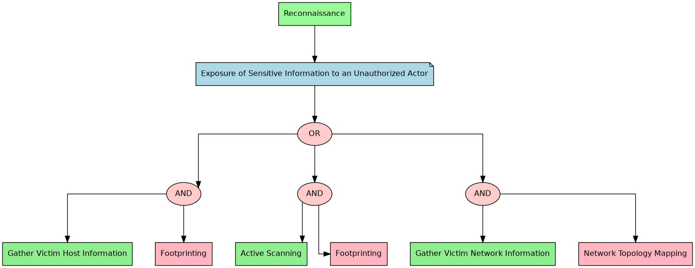</a>

</td></tr>
<tr><td align="center"><sub>Reconnaissance.png</sub></td></tr>
</table>


<details>
<summary>**Persistence**: 5 paths, 3 CWEs, 2 techniques, 2 CAPECs (3695 px wide)</summary>

<table>
<tr><td align="center">

<a href="schneider-electric_modicon_m580/outputs/tactic_trees/Persistence.svg">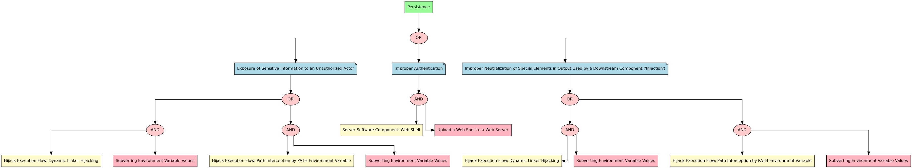</a>

</td></tr>
<tr><td align="center"><sub>Persistence.png</sub></td></tr>
</table>


</details>

<details>
<summary>**Privilege Escalation**: 10 paths, 4 CWEs, 3 techniques, 6 CAPECs (7833 px wide)</summary>

<table>
<tr><td align="center">

<a href="schneider-electric_modicon_m580/outputs/tactic_trees/Privilege_Escalation.svg">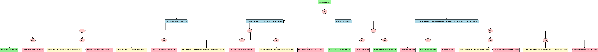</a>

</td></tr>
<tr><td align="center"><sub>Privilege_Escalation.png</sub></td></tr>
</table>


</details>

<details>
<summary>**Defense Evasion**: 19 paths, 4 CWEs, 8 techniques, 10 CAPECs (14733 px wide)</summary>

<table>
<tr><td align="center">

<a href="schneider-electric_modicon_m580/outputs/tactic_trees/Defense_Evasion.svg"></a>

</td></tr>
<tr><td align="center"><sub>Defense_Evasion.png</sub></td></tr>
</table>


</details>

<details>
<summary>**Credential Access**: 10 paths, 5 CWEs, 8 techniques, 8 CAPECs (5518 px wide)</summary>

<table>
<tr><td align="center">

<a href="schneider-electric_modicon_m580/outputs/tactic_trees/Credential_Access.svg">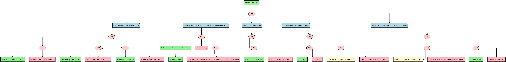</a>

</td></tr>
<tr><td align="center"><sub>Credential_Access.png</sub></td></tr>
</table>


</details>

<details>
<summary>**Discovery**: 19 paths, 3 CWEs, 17 techniques, 17 CAPECs (9836 px wide)</summary>

<table>
<tr><td align="center">

<a href="schneider-electric_modicon_m580/outputs/tactic_trees/Discovery.svg">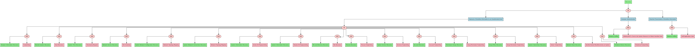</a>

</td></tr>
<tr><td align="center"><sub>Discovery.png</sub></td></tr>
</table>


</details>

<details>
<summary>**Lateral Movement**: 4 paths, 3 CWEs, 2 techniques, 2 CAPECs (2545 px wide)</summary>

<table>
<tr><td align="center">

<a href="schneider-electric_modicon_m580/outputs/tactic_trees/Lateral_Movement.svg">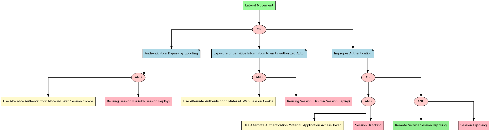</a>

</td></tr>
<tr><td align="center"><sub>Lateral_Movement.png</sub></td></tr>
</table>


</details>

**Collection**: 4 paths, 3 CWEs, 3 techniques, 3 CAPECs (1715 px wide)

<table>
<tr><td align="center">

<a href="schneider-electric_modicon_m580/outputs/tactic_trees/Collection.svg">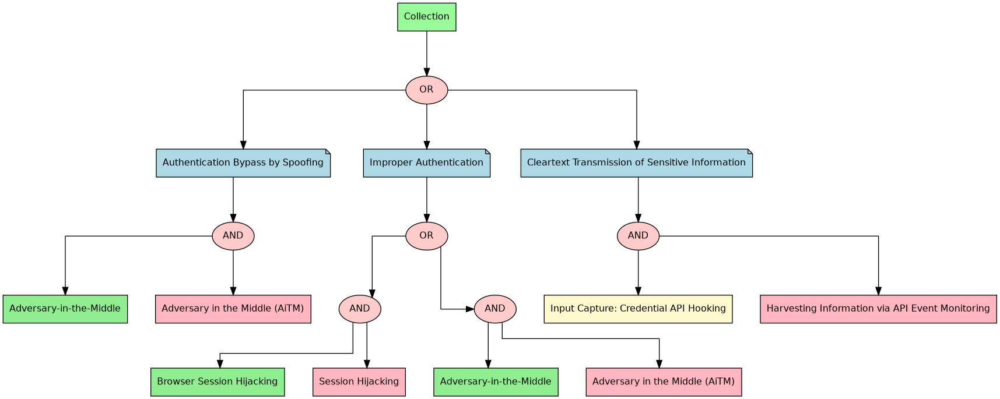</a>

</td></tr>
<tr><td align="center"><sub>Collection.png</sub></td></tr>
</table>


### Step 7: Comprehensive tree

Sources: `schneider-electric_modicon_m580/outputs/comprehensive_tree/summary.csv`, `dedup_comparison.csv`, `run_summary.json`. **74 paths, 283 nodes, 282 edges, 8 tactics.**

| dedup_mode | total_paths | total_nodes | total_edges | cross_tactic_duplicates_removed | pruned_rows_cross_tactic | pruned_rows_within_tactic | tactics_represented |
|---|---|---|---|---|---|---|---|
| per_tactic | 74 | 283 | 282 | 0 | 48 | 110 | 8 |

Paths kept per tactic under each deduplication rule (`dedup_comparison.csv`; the run used `per_tactic`):

| tactic | per_tactic_count | earliest_tactic_count | difference |
|---|---|---|---|
| Reconnaissance | 3 | 3 | 0 |
| Persistence | 5 | 5 | 0 |
| Privilege Escalation | 10 | 6 | 4 |
| Defense Evasion | 19 | 9 | 10 |
| Credential Access | 10 | 10 | 0 |
| Discovery | 19 | 17 | 2 |
| Lateral Movement | 4 | 1 | 3 |
| Collection | 4 | 1 | 3 |
| TOTAL | 74 | 52 | 22 |

The tree is drawn left to right, so it is tall rather than wide (4,002 × 10,383 px for M580), and the box below shows it scaled down (text is small). Full-size: [`.svg`](schneider-electric_modicon_m580/outputs/comprehensive_tree/comprehensive_attack_tree.svg), [`.png`](schneider-electric_modicon_m580/outputs/comprehensive_tree/comprehensive_attack_tree.png), [`.html`](schneider-electric_modicon_m580/outputs/comprehensive_tree/comprehensive_attack_tree.html) (interactive).

<table>
<tr><td align="center">

<a href="schneider-electric_modicon_m580/outputs/comprehensive_tree/comprehensive_attack_tree.svg"></a>

</td></tr>
<tr><td align="center"><sub>Comprehensive attack tree (scaled down) : click for the full SVG</sub></td></tr>
</table>

### Step 8: Sensitivity to missing CTI links

Sources: `schneider-electric_modicon_m580/sensitivity.csv`, `schneider-electric_modicon_m580/sensitivity_critical_links.csv`. Links of the given type are removed at random with probability *p* (500 replicates, seed 2026). Share of the 74 paths retained, mean [bootstrap CI]:

| Links removed | p = 0.1 | p = 0.2 | p = 0.3 | p = 0.4 | p = 0.5 |
|---|---|---|---|---|---|
| cve_cwe | 0.951 [0.944, 0.958] | 0.893 [0.883, 0.903] | 0.842 [0.831, 0.853] | 0.788 [0.775, 0.800] | 0.717 [0.704, 0.731] |
| cwe_capec | 0.898 [0.892, 0.904] | 0.801 [0.794, 0.809] | 0.700 [0.692, 0.708] | 0.606 [0.598, 0.615] | 0.499 [0.491, 0.508] |
| capec_technique | 0.902 [0.898, 0.907] | 0.794 [0.788, 0.801] | 0.702 [0.695, 0.710] | 0.594 [0.586, 0.602] | 0.502 [0.494, 0.510] |
| technique_tactic | 0.898 [0.894, 0.902] | 0.800 [0.795, 0.805] | 0.702 [0.696, 0.708] | 0.605 [0.599, 0.612] | 0.502 [0.496, 0.508] |
| all | 0.696 [0.688, 0.704] | 0.461 [0.452, 0.469] | 0.295 [0.288, 0.303] | 0.167 [0.162, 0.173] | 0.094 [0.090, 0.099] |

Share of the 8 tactics that keep at least one path (mean):

| Links removed | p = 0.1 | p = 0.2 | p = 0.3 | p = 0.4 | p = 0.5 |
|---|---|---|---|---|---|
| cve_cwe | 1.000 | 1.000 | 0.998 | 0.995 | 0.984 |
| cwe_capec | 0.998 | 0.991 | 0.983 | 0.962 | 0.933 |
| capec_technique | 1.000 | 0.997 | 0.988 | 0.966 | 0.938 |
| technique_tactic | 1.000 | 0.996 | 0.987 | 0.965 | 0.939 |
| all | 0.987 | 0.922 | 0.817 | 0.648 | 0.478 |

Single CVE -> CWE links, ranked by paths lost:

| Rank | CVE -> CWE link removed | Paths lost | Share |
|---|---|---|---|
| 1 | CVE-2018-7847 -> CWE-287 | 15 | 20.3% |
| 2 | CVE-2018-7842 -> CWE-290 | 12 | 16.2% |
| 3 | CVE-2020-7475 -> CWE-74 | 8 | 10.8% |
| 4 | CVE-2019-6821 -> CWE-330 | 2 | 2.7% |
| 5 | CVE-2018-7844 -> CWE-200 | 0 | 0.0% |

Greedy removal of CWE -> CAPEC links:

| Step | CWE -> CAPEC link removed (greedy) | Paths lost | Cumulative lost | Cumulative share |
|---|---|---|---|---|
| 1 | CWE-200 -> CAPEC-13 | 7 | 7 | 9.5% |
| 2 | CWE-74 -> CAPEC-13 | 7 | 14 | 18.9% |
| 3 | CWE-200 -> CAPEC-60 | 4 | 18 | 24.3% |
| 4 | CWE-287 -> CAPEC-593 | 4 | 22 | 29.7% |
| 5 | CWE-290 -> CAPEC-21 | 4 | 26 | 35.1% |

### Step 9: Insights

Source: `schneider-electric_modicon_m580/outputs/insights/insights.json` (also `.md`, `.html`). Overview: CVEs in scope 40, CVEs reaching a tactic 11, Weaknesses 6, CAPEC patterns 33, Techniques 38, Tactics 8, Paths 74.

1. **One weakness, many stages** :Exposure of Sensitive Information to an Unauthorized Actor (CWE-200) underlies 5 of 40 CVEs and reaches 7 of 8 tactic subtrees. Ranked one by one they read as separate findings; the tree groups them under one recurring weakness.
2. **Path count is not CVE count** :Defense Evasion has 19 paths from 8 CVEs, while Lateral Movement has 4 paths from 7 CVEs. Here CVE count tracks path count closely, so it is a fair proxy.
3. **Redundancy shows where one control helps twice**: 50 CAPEC references collapse to 33 distinct patterns (34.0% repeat one already used in another tactic). The same mechanisms recur across stages, so one control can cut paths in several of them.
4. **Where a fix removes the most paths** :Fixing CVE-2018-7847 alone removes 15 of 74 paths (20.3%), the most of any single CVE. It also has the highest base score.
5. **How easily the paths can be reached**: 74 of 74 paths (100.0%) can be driven remotely: at least one supporting CVE is reachable over the network with no privileges and no user interaction.
6. **Which weakness feeds the most paths** :Exposure of Sensitive Information to an Unauthorized Actor (CWE-200) supports 33 of 74 paths (44.6%) from 5 CVEs.
7. **Where public mappings run out** :The paths reach 8 of 14 ATT&CK tactics. Most dropped chain rows (259 of 290) are lost at one step: CAPEC pattern has no ATT&CK technique.

---

## 3. Manual validation: Baxter Sigma Spectrum Infusion System

Sources: `validation_Baxter/Inter-annotator-reliability.xlsx` (sheets `consensus`, `Results`, `A1_annotation`, `A2_annotation`, `Reference_Documents`, `Labeling_Guide`), per-annotator folders `validation_Baxter/Annotator_1/`, `validation_Baxter/Annotator_2/`. 2 annotators labelled each of the 51 paths as *Confirmed*, *Plausible*, *No supporting evidence found* against 7 reference documents (`validation_Baxter/Annotator_1/supporting_document/D0001.pdf` to `validation_Baxter/Annotator_1/supporting_document/D0007.pdf`).

**Validation of the 51 paths (consensus labels)** (`Results` sheet):

| Tactic | Confirmed | Plausible | No supporting evidence found | Total |
|---|---|---|---|---|
| Initial Access | 1 | 0 | 0 | 1 |
| Credential Access | 1 | 4 | 1 | 6 |
| Persistence | 1 | 2 | 6 | 9 |
| Privilege Escalation | 1 | 7 | 3 | 11 |
| Defense Evasion | 1 | 8 | 5 | 14 |
| Discovery | 0 | 2 | 1 | 3 |
| Lateral Movement | 0 | 2 | 1 | 3 |
| Collection | 2 | 0 | 2 | 4 |
| Total | 7 | 25 | 19 | 51 |

Overall: Confirmed 13.7%, Plausible 49.0%, No supporting evidence found 37.3%.

**Inter-annotator agreement** (`Results` sheet):

| What the two annotators said | Paths (all 51) | Unique path keys |
|---|---|---|
| Both said Confirmed | 7 | 3 |
| Both said Plausible | 21 | 11 |
| Both said No supporting evidence found | 15 | 8 |
| A1 said Plausible, A2 said No supporting evidence found | 8 | 5 |
| Any other combination | 0 | 0 |
| Total | 51 | 27 |
| Number where A1 and A2 agree | 43 | 22 |
| Percent agreement | 0.843 | 0.815 |
| Agreement expected by chance | 0.386 | 0.396 |
| Cohen's kappa | 0.745 | 0.693 |

<details>
<summary>Show the consensus label for all 51 paths (`consensus` sheet)</summary>

| Path ID | Tactic | A1 Validation | A2 Validation | Consensus Label |
|---|---|---|---|---|
| P001 | Initial Access | Confirmed | Confirmed | Confirmed |
| P002 | Persistence | Confirmed | Confirmed | Confirmed |
| P003 | Persistence | Plausible | No supporting evidence found | No supporting evidence found |
| P004 | Persistence | Plausible | Plausible | Plausible |
| P005 | Persistence | No supporting evidence found | No supporting evidence found | No supporting evidence found |
| P006 | Persistence | No supporting evidence found | No supporting evidence found | No supporting evidence found |
| P007 | Persistence | Plausible | Plausible | Plausible |
| P008 | Persistence | No supporting evidence found | No supporting evidence found | No supporting evidence found |
| P009 | Persistence | No supporting evidence found | No supporting evidence found | No supporting evidence found |
| P010 | Persistence | No supporting evidence found | No supporting evidence found | No supporting evidence found |
| P011 | Privilege Escalation | Confirmed | Confirmed | Confirmed |
| P012 | Privilege Escalation | Plausible | Plausible | Plausible |
| P013 | Privilege Escalation | Plausible | Plausible | Plausible |
| P014 | Privilege Escalation | Plausible | No supporting evidence found | Plausible |
| P015 | Privilege Escalation | Plausible | Plausible | Plausible |
| P016 | Privilege Escalation | Plausible | Plausible | Plausible |
| P017 | Privilege Escalation | No supporting evidence found | No supporting evidence found | No supporting evidence found |
| P018 | Privilege Escalation | No supporting evidence found | No supporting evidence found | No supporting evidence found |
| P019 | Privilege Escalation | Plausible | Plausible | Plausible |
| P020 | Privilege Escalation | Plausible | No supporting evidence found | Plausible |
| P021 | Privilege Escalation | No supporting evidence found | No supporting evidence found | No supporting evidence found |
| P022 | Defense Evasion | Confirmed | Confirmed | Confirmed |
| P023 | Defense Evasion | Plausible | Plausible | Plausible |
| P024 | Defense Evasion | Plausible | Plausible | Plausible |
| P025 | Defense Evasion | Plausible | Plausible | Plausible |
| P026 | Defense Evasion | Plausible | No supporting evidence found | Plausible |
| P027 | Defense Evasion | Plausible | Plausible | Plausible |
| P028 | Defense Evasion | Plausible | Plausible | Plausible |
| P029 | Defense Evasion | No supporting evidence found | No supporting evidence found | No supporting evidence found |
| P030 | Defense Evasion | No supporting evidence found | No supporting evidence found | No supporting evidence found |
| P031 | Defense Evasion | Plausible | Plausible | Plausible |
| P032 | Defense Evasion | No supporting evidence found | No supporting evidence found | No supporting evidence found |
| P033 | Defense Evasion | Plausible | No supporting evidence found | Plausible |
| P034 | Defense Evasion | Plausible | No supporting evidence found | No supporting evidence found |
| P035 | Defense Evasion | No supporting evidence found | No supporting evidence found | No supporting evidence found |
| P036 | Credential Access | Plausible | Plausible | Plausible |
| P037 | Credential Access | Plausible | Plausible | Plausible |
| P038 | Credential Access | Confirmed | Confirmed | Confirmed |
| P039 | Credential Access | Plausible | Plausible | Plausible |
| P040 | Credential Access | No supporting evidence found | No supporting evidence found | No supporting evidence found |
| P041 | Credential Access | Plausible | Plausible | Plausible |
| P042 | Discovery | Plausible | Plausible | Plausible |
| P043 | Discovery | Plausible | Plausible | Plausible |
| P044 | Discovery | No supporting evidence found | No supporting evidence found | No supporting evidence found |
| P045 | Lateral Movement | Plausible | Plausible | Plausible |
| P046 | Lateral Movement | Plausible | Plausible | Plausible |
| P047 | Lateral Movement | Plausible | No supporting evidence found | No supporting evidence found |
| P048 | Collection | Plausible | No supporting evidence found | No supporting evidence found |
| P049 | Collection | Confirmed | Confirmed | Confirmed |
| P050 | Collection | Confirmed | Confirmed | Confirmed |
| P051 | Collection | No supporting evidence found | No supporting evidence found | No supporting evidence found |

</details>

<details>
<summary>Show the 7 reference documents (`Reference_Documents` sheet)</summary>

| Doc ID | Tag | Reference URL |
|---|---|---|
| D0001 | Mitigation, Third Party Advisory, US Government Resource | https://www.cisa.gov/news-events/ics-advisories/icsa-15-181-01 |
| D0002 | Third Party Advisory, US Government Resource | https://www.cisa.gov/news-events/ics-medical-advisories/icsma-20-170-04 |
| D0003 | Third Party Advisory, US Government Resource | https://www.cisa.gov/uscert/ics/advisories/icsma-22-251-01 |
| D0004 | Vendor Advisory / Product Security Bulletin | https://p1.aprimocdn.net/hillrom/26e03e14-fb91-4c71-9935-b3af014e0821/Spectrum-Ripple20_ICSA-20-168-01_October2024_Original%20file.pdf |
| D0005 | NIST Special Publication / Authoritative Technical Reference | https://www.nccoe.nist.gov/publication/1800-8/VolB/ |
| D0006 | Patent document | https://patents.google.com/patent/US10071202B2/en |
| D0007 | Rapid7 | https://www.rapid7.com/blog/post/2022/09/08/baxter-sigma-spectrum-infusion-pumps-multiple-vulnerabilities-fixed/ |

</details>

Dashboard of `validation_Baxter/Annotator_1/` (`validation_Baxter/Annotator_1/00_dashboard.png`). This dashboard shows Annotator_1's own labels before the discussion round (7 Confirmed / 29 Plausible / 15 No supporting evidence found). The consensus labels in the table above (7 / 25 / 19) are the final labels.

<table>
<tr><td align="center">

<a href="validation_Baxter/Annotator_1/00_dashboard.png">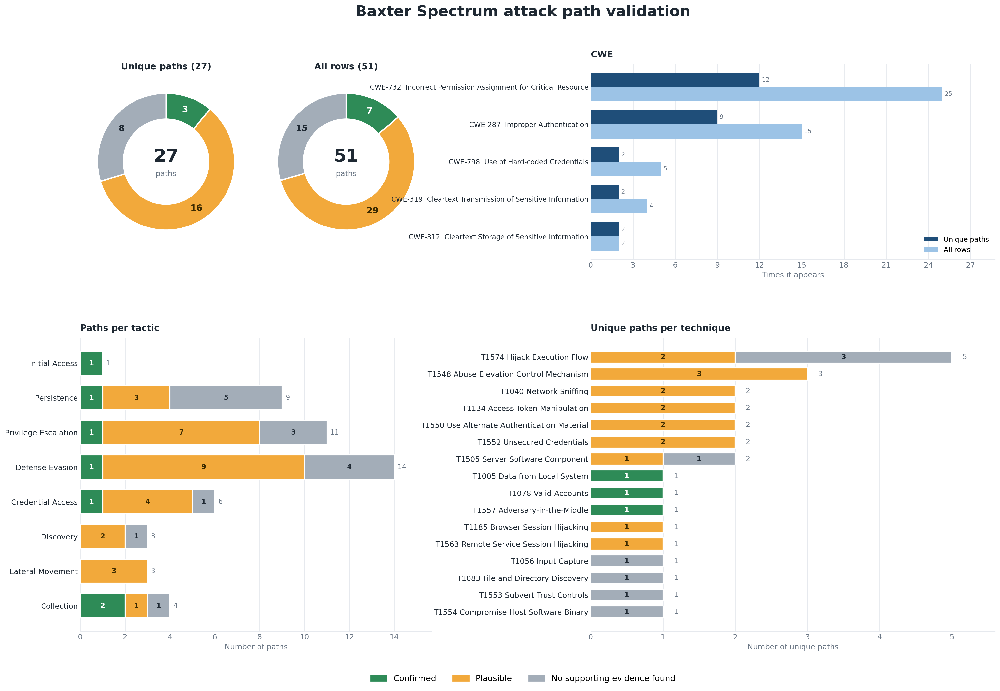</a>

</td></tr>
<tr><td align="center"><sub>Annotator_1 dashboard : click to enlarge</sub></td></tr>
</table>
